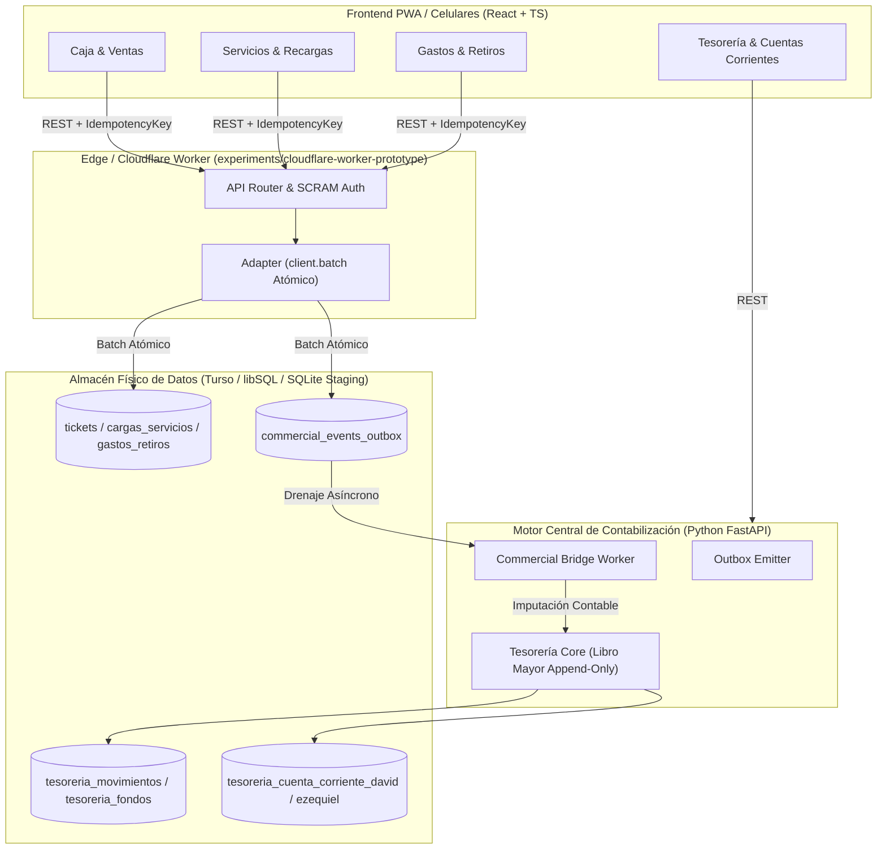

# GENAROPOS V4 — DISEÑO TÉCNICO DE CONSOLIDACIÓN (FASE IV-C)
## Especificación Arquitectural, Modelos de Datos y Estrategia de Pruebas

**Proyecto:** GenaroPOS V4  
**Fecha:** 06/11/2026  
**Ámbito:** STAGING / Arquitectura Centralizada de Contabilización  
**Estado:** DOCUMENTO DE DISEÑO TÉCNICO (Sin Modificación de Código)  

---

## 1. RESUMEN ARQUITECTURAL DE INTEGRACIÓN



---

## 2. COMPONENTES Y ARCHIVOS INVOLUCRADOS

| Subsistema | Archivo Principal | Rol Técnico | Modificaciones Previstas en Fase IV-D |
| :--- | :--- | :--- | :--- |
| **Servicios / Recargas** | `tesoreria/commercial_bridge_worker.py` | Procesamiento contable de eventos outbox | Incorporar desglose de comisiones Claro/MP y asiento transitorio de pasivo Claro. |
| **Outbox Observabilidad** | `api/routers/commercial_bridge.py` | Endpoints de estado para Cajero y Admin | Exponer diagnósticos enriquecidos con métrica `held_pending_definition`. |
| **Cuenta Corriente** | `tesoreria/cuenta_corriente_ezequiel.py` *(Nuevo)* | Lógica financiera de cuenta corriente Ezequiel | Homologar diseño al de David con validación estricta de balance append-only. |
| **Migración 015** | `db/migrations/015_cuenta_corriente_ezequiel.sql` *(Nuevo)* | DDL físico de tabla e índices | Reemplazar `ON DELETE CASCADE` por `ON DELETE RESTRICT` e integrar con `tesoreria_movimientos`. |
| **Readiness** | `db/readiness.py` | Diagnóstico de integridad de esquema | Catalogar la migración 015 y sus claves foráneas requeridas. |
| **Frontend UI** | `frontend/src/components/TesoreriaLab.tsx` | Interfaz de visualización y gestión | Incorporar pestaña y filtros para la Cuenta Corriente de Ezequiel. |

---

## 3. CORRECCIÓN Y PERFECCIONAMIENTO DEL DDL: MIGRACIÓN 015

### 3.1. Crítica al Modelo Anterior
El borrador inicial de `015` contenía:
- `saldo_resultante_centavos` mutable en la cabecera.
- Tabla de auditoría con `ON DELETE CASCADE` (violación del principio de auditoría inmutable).
- Desconexión con `tesoreria_movimientos` (no utilizaba `movement_id`).

### 3.2. DDL Definitivo Propuesto (Homologado con David)

```sql
-- Migración 015: Cuenta Corriente Ezequiel (Homologada con tesoreria_cuenta_corriente_david)
-- Principio: Inmutable, append-only, con claves foráneas protegidas (ON DELETE RESTRICT).

CREATE TABLE IF NOT EXISTS tesoreria_cuenta_corriente_ezequiel (
    id INTEGER PRIMARY KEY AUTOINCREMENT,
    operation_id TEXT NOT NULL UNIQUE,
    idempotency_key TEXT NOT NULL UNIQUE,
    tipo_movimiento TEXT NOT NULL CHECK(tipo_movimiento IN ('ENTREGA_MERCADERIA', 'PAGO_EFECTIVO', 'PAGO_TRANSFERENCIA', 'RETIRO_FONDOS', 'AJUSTE_COMPENSATORIO', 'RECONOCIMIENTO_SALDO_INICIAL')),
    monto_cents INTEGER NOT NULL CHECK(monto_cents > 0),
    fecha_referencia TEXT NOT NULL,
    recorded_at_utc TEXT NOT NULL DEFAULT (datetime('now')),
    movement_id TEXT,
    fondo_afectado TEXT CHECK(fondo_afectado IN ('1110', '1210') OR fondo_afectado IS NULL),
    referencia_externa TEXT,
    motivo TEXT NOT NULL CHECK(length(trim(motivo)) > 0),
    actor TEXT NOT NULL CHECK(length(trim(actor)) > 0),
    jornada_id INTEGER,
    anulado INTEGER NOT NULL DEFAULT 0 CHECK(anulado IN (0, 1)),
    anulado_por TEXT,
    anulado_fecha_utc TEXT,
    motivo_anulacion TEXT,
    created_at TEXT NOT NULL DEFAULT (datetime('now')),
    FOREIGN KEY (movement_id) REFERENCES tesoreria_movimientos(movement_id) ON DELETE RESTRICT,
    FOREIGN KEY (jornada_id) REFERENCES tesoreria_jornadas(id) ON DELETE RESTRICT
);

CREATE INDEX IF NOT EXISTS idx_cc_ezequiel_tipo ON tesoreria_cuenta_corriente_ezequiel(tipo_movimiento);
CREATE INDEX IF NOT EXISTS idx_cc_ezequiel_movement ON tesoreria_cuenta_corriente_ezequiel(movement_id);
CREATE INDEX IF NOT EXISTS idx_cc_ezequiel_idempotency ON tesoreria_cuenta_corriente_ezequiel(idempotency_key);
CREATE INDEX IF NOT EXISTS idx_cc_ezequiel_fecha ON tesoreria_cuenta_corriente_ezequiel(fecha_referencia);
CREATE INDEX IF NOT EXISTS idx_cc_ezequiel_anulado ON tesoreria_cuenta_corriente_ezequiel(anulado);

-- Tabla de auditoría inmutable: NUNCA se borran registros de auditoría
CREATE TABLE IF NOT EXISTS tesoreria_cc_ezequiel_auditoria (
    id INTEGER PRIMARY KEY AUTOINCREMENT,
    movimiento_id INTEGER NOT NULL,
    accion TEXT NOT NULL CHECK(accion IN ('CREAR', 'ANULAR')),
    valores_anteriores TEXT,
    valores_nuevos TEXT,
    fecha_utc TEXT NOT NULL DEFAULT (datetime('now')),
    actor TEXT NOT NULL DEFAULT 'sistema',
    FOREIGN KEY (movimiento_id) REFERENCES tesoreria_cuenta_corriente_ezequiel(id) ON DELETE RESTRICT
);

CREATE INDEX IF NOT EXISTS idx_audit_cc_ezequiel_mov ON tesoreria_cc_ezequiel_auditoria(movimiento_id);
```

---

## 4. ESTRATEGIA DE PRUEBAS DE LA FASE IV-E

Una vez que se autorice la implementación, se ejecutarán las 8 pruebas integrales obligatorias:
1. **Escenario A — Venta en Efectivo:** Inserción de venta, deducción de stock y `ENTRY 1110` en Tesorería.
2. **Escenario B — Venta en Transferencia:** Inserción de venta, deducción de stock y `ENTRY 1210` en Tesorería.
3. **Escenario C — Recarga PREPAY Efectivo:** Deducción de saldo digital `1220`, entrada a bolsa `1160` y ganancia a `1140`.
4. **Escenario D — Recarga Claro Efectivo vs. Transferencia:**
   - En Efectivo: entrada a custodia `1150` y comisión a `1110`.
   - En Transferencia: entrada a `1210` y pasivo compensatorio Claro.
5. **Escenario E — Alta de Gasto con Simulación de Fallo:** Reversión completa en SQLite ante error en auditoría u Outbox.
6. **Escenario F — Reintentos Concurrentes Idempotentes:** 10 llamadas paralelas con la misma clave resultan en 1 solo movimiento contable.
7. **Escenario G — Drenaje de Outbox con Fallo Simulador:** Verificación de reintentos exponenciales y estado `DEAD_LETTER`.
8. **Escenario H — Anulación de Venta y Servicio:** Generación de contra-asiento reversible sin eliminar el ticket original.
