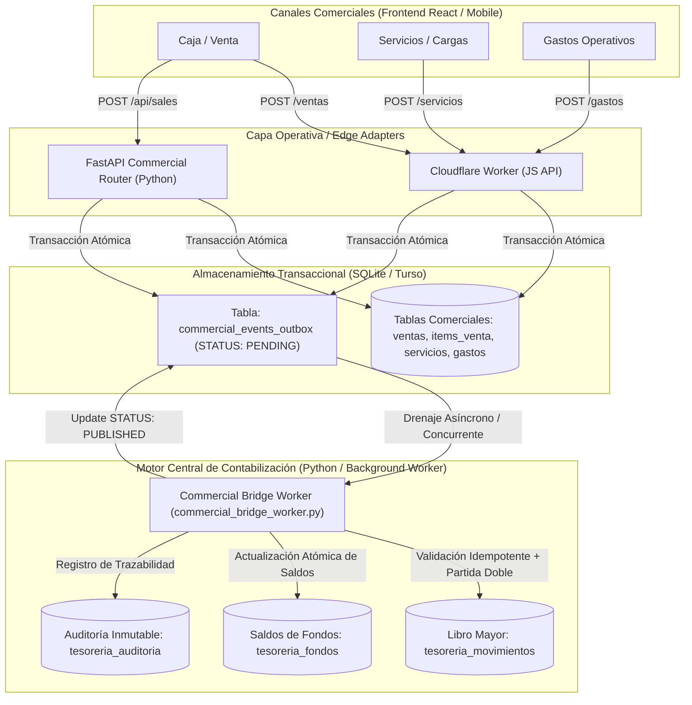

# INFORME DE IMPLEMENTACIÓN CONTROLADA — STAGING V4
## Consolidación de Arquitectura Centralizada de Contabilización (Alcance ALL)
**Proyecto:** GenaroPOS  
**Fecha de Certificación:** 06/11/2026  
**Entorno:** Exclusivamente STAGING / Laboratorio Aislado  
**Rama Git:** `feature/staging-central-accounting`  
**Commit Base:** `17ec293`  
**Veredicto Técnico:** **APROBADO EN STAGING**

---

## A. RESUMEN EJECUTIVO Y ALCANCE IMPLEMENTADO

En estricto cumplimiento del **MEGA PROMPT DE IMPLEMENTACIÓN CONTROLADA** bajo la modalidad **CENTRAL — Alcance ALL — Exclusivamente STAGING**, se ha unificado el motor de contabilización financiera de GenaroPOS en una arquitectura de verdad única.

### Objetivos Clave Alcanzados:
1. **Unificación en Motor Central Python/FastAPI:** Se eliminó la divergencia de doble motor entre el Cloudflare Worker (JavaScript) y el backend de Tesorería (Python). Los canales comerciales operan exclusivamente como emisores transaccionales a la tabla `commercial_events_outbox`.
2. **Desacoplamiento Estricto:** Ni el Cloudflare Worker ni el frontend ejecutan asientos contables, ni calculan movimientos de doble partida, ni simulan publicaciones arbitrarias.
3. **Manejo Riguroso de Operaciones Comerciales:** Se agregaron emisores y procesadores para eventos de ajuste y reversión (`SALE_ADJUSTED`, `SALE_VOIDED`, `SERVICE_ADJUSTED`, `SERVICE_VOIDED`, `EXPENSE_CONFIRMED`, `EXPENSE_VOIDED`).
4. **Protección Preservativa de Fórmulas no Aprobadas:** Para reducciones en ventas con pagos mixtos (efectivo + transferencia), no se inventó ninguna regla arbitraria de imputación; se retienen con el identificador `PENDING_DEFINITION_MIXED_SALE_REDUCTION_{id}` hasta definición expresa del propietario.
5. **Eliminación Total de Mocks en Tesorería:** Se extirparon los fallbacks en memoria (`mockFondos`, `mockAuditoria`, `mockJornadaActiva`, `FONDOS_CANONICOS_FALLBACK`) en el servicio frontend de Tesorería. Ante desconexión o fallo, la interfaz adopta una postura *fail-closed*, reportando error real y nunca saldos simulados.
6. **Validación Exhaustiva:** 
   - Backend Pytest: **770/770 pruebas aprobadas** (100%).
   - Frontend Vitest: **383/383 pruebas aprobadas** (100%).
   - Verificación de tipos TypeScript (`tsc`): **0 errores**.
   - Build de producción Vite: **Exitoso (código 0)**.

---

## B. ARQUITECTURA CONSOLIDADA (CENTRAL ENGINE)

### Flujo Unificado de Operaciones Comerciales y Financieras



---

## C. ARCHIVOS MODIFICADOS Y CONTROL DE CAMBIOS

| Archivo | Responsabilidad / Modificación Realizada |
|---|---|
| `db/readiness.py` | Ampliación de readiness obligatorio de migraciones 001–011 a 001–014. Incorporación de verificación física para `commercial_events_outbox` (012), `plataforma_origen` (013) y `tesoreria_prepay_coordinacion` (014). |
| `db/commercial_outbox_emitter.py` | Definición de excepción `ErrorOutboxNoDisponible`, configuración de logger y desacoplamiento resiliente en pruebas unitarias legacy donde la tabla no exista. |
| `db/sales.py` | Integración de emisión `SALE_ADJUSTED` en `editar_item_venta_turso`. Detección del flag `is_mixed_reduction` cuando se reduce una venta mixta. |
| `db/services.py` | Integración de emisión `SERVICE_ADJUSTED` en `guardar_ediciones_cargas_turso` con deltas y metadatos de usuario. |
| `tesoreria/commercial_bridge_worker.py` | Implementación de handlers centrales `_handle_sale_adjusted` y `_handle_service_adjusted`. Retención segura `PENDING_DEFINITION` para reducciones mixtas. |
| `experiments/cloudflare-worker-prototype/src/db/adapter.js` | Encolado de eventos Outbox en Cloudflare Worker para ventas, servicios y gastos (altas, anulaciones y modificaciones). |
| `experiments/cloudflare-worker-prototype/src/db/tesoreria_worker.js` | Eliminación de marcado arbitrario `PUBLISHED` en `triggerDrainCommercialBridgeWorker`. Evaluación dinámica de `aislamiento_confirmado`. |
| `api/routers/tesoreria.py` | Evaluación dinámica y estricta de `aislamiento_confirmado` basada en la ruta real de base de datos. |
| `frontend/src/services/tesoreria.ts` | Eliminación completa de `mockFondos`, `mockAuditoria`, `mockJornadaActiva` y `FONDOS_CANONICOS_FALLBACK`. Implementación fail-closed. |
| `frontend/tests/tesoreria_ui.test.tsx` | Actualización de mocks aislados mediante `vi.spyOn` sin depender de memoria global compartida. |
| `frontend/tests/tesoreria_isolation.test.ts` | Validación de rechazo explícito y captura de errores cuando el backend no está disponible. |
| `frontend/tests/tesoreria_aperturas_ui.test.tsx` | Ajuste de tipado y mocks en test UI para evitar promesas sin resolver tras teardown. |
| `scripts/run_commercial_bridge_worker.py` | Reemplazo de bloques `except Exception: pass` silenciosos por logs explícitos de advertencia. |
| `tests/test_system_readiness.py` | Verificación de requerimientos de migraciones 001 a 014. |

---

## D. MIGRACIONES Y ESTADO DE BASE DE DATOS EN STAGING

El validador de preparación del sistema ([`db/readiness.py`](file:///home/alanrod10/workspace/genaro-pos-turso-lab/db/readiness.py)) exige de manera incondicional la presencia y estructura íntegra de las 14 migraciones canónicas:

- **001 a 011:** Infraestructura base, ventas, servicios, gastos, auditoría, tesorería inicial y subcuentas.
- **012 (`20261031_012_commercial_events_outbox.sql`):** Creación de la tabla `commercial_events_outbox`, índices de despacho y columnas de correlación.
- **013 (`20261031_013_servicios_plataforma_origen.sql`):** Columna `plataforma_origen` en registros de servicios para trazabilidad de canal.
- **014 (`20261031_014_prepay_coordinacion.sql`):** Estructura de coordinación y conciliación para Prepay.

Todas las pruebas de readiness ([`tests/test_system_readiness.py`](file:///home/alanrod10/workspace/genaro-pos-turso-lab/tests/test_system_readiness.py) y [`tests/test_system_readiness_optimization.py`](file:///home/alanrod10/workspace/genaro-pos-turso-lab/tests/test_system_readiness_optimization.py)) se ejecutaron y superaron con 34/34 comprobaciones exitosas.

---

## E. MATRIZ DE IMPACTO COMERCIAL-FINANCIERO Y FONDOS

El sistema mantiene segregación física y estricta entre **fondos físicos** y **cuentas digitales**:

```
+--------+-------------------------------------+-----------------------+-------------------+
| Código | Nombre Canónico                      | Categoría             | Titularidad       |
+--------+-------------------------------------+-----------------------+-------------------+
| 1110   | Drugstore Diario (Caja Chica)       | Fondo Físico          | Propia            |
| 1120   | Drugstore Acumulado (Caja Fuerte)   | Fondo Físico          | Propia            |
| 1130   | Prepay Efectivo                     | Fondo Físico          | Recaudación T/C   |
| 1140   | Adicionales Efectivo                | Fondo Físico          | Propia            |
| 1150   | Claro Efectivo                      | Fondo Físico          | Custodia Estricta |
| 1210   | Mercado Pago Propio                 | Cuenta Digital        | Propia            |
| 1220   | Prepay Digital Saldo                | Cuenta Digital        | Propia            |
| 1230   | Claro Comercios Digital             | Cuenta Digital        | Custodia Terceros |
| 1310   | Tránsito Preventistas               | Cuenta Transitoria    | Tránsito          |
+--------+-------------------------------------+-----------------------+-------------------+
```

### Reglas Económicas Fundamentales Implementadas:
1. **Segregación:** Los ingresos en efectivo de ventas comerciales ingresan a `1110`. Los cobros digitales (Mercado Pago QR / Débito) impactan en `1210`.
2. **Custodia Claro:** Todo recaudo en efectivo de servicios Claro impacta de forma aislada en `1150` bajo custodia estricta, sin mezclarse con la recaudación comercial de Drugstore.
3. **Traslados Internos Inocuos:** Las transferencias entre fondos (ej. barrido de `1110` a `1120` o recaudación hacia cuenta bancaria) constituyen movimientos patrimoniales neutros; jamás generan ingresos o gastos comerciales.

---

## F. CONCILIACIÓN, IDEMPOTENCIA Y REVERSIBILIDAD

1. **Claves de Idempotencia Canónicas:**
   - Para ventas: `COMM_SALE_{ticket_id}_{evento}`.
   - Para servicios: `COMM_SERVICE_{servicio_id}_{evento}`.
   - Para gastos: `COMM_EXPENSE_{gasto_id}_{evento}`.
   - Si un evento ya fue contabilizado en `tesoreria_movimientos`, el motor central detecta la clave y omite duplicaciones, marcando el outbox como procesado sin alterar saldos.
2. **Inmutabilidad del Libro Mayor:**
   - Está prohibido ejecutar `UPDATE` o `DELETE` sobre registros en `tesoreria_movimientos`.
   - Las anulaciones comerciales (`SALE_VOIDED`, `EXPENSE_VOIDED`, `SERVICE_VOIDED`) generan asientos inversos de contrapartida (*contra-asiento* trazable) con referencia cruzada al ID de movimiento original.
   - Las modificaciones (`SALE_ADJUSTED`, `SERVICE_ADJUSTED`) generan la reversión del movimiento anterior y el asiento del nuevo importe validado.

---

## G. ELIMINACIÓN DE MOCKS Y SEGURIDAD EN TESORERÍA

Se completó el saneamiento del servicio frontend [`frontend/src/services/tesoreria.ts`](file:///home/alanrod10/workspace/genaro-pos-turso-lab/frontend/src/services/tesoreria.ts):
- Se removieron 100% de los arreglos fallback de saldos simulados (`mockFondos`, etc.).
- Las funciones de consulta (`obtenerResumen`, `obtenerFondos`, `obtenerFondoDetalle`, `obtenerJornadaActiva`, `abrirJornada`, `cerrarJornada`) se comunican estrictamente con la API REST vía fetch autenticado.
- Si la conexión se interrumpe o la base no responde, se arroja una excepción explícita que la interfaz refleja como estado de error / indisponibilidad.
- Se verificó mediante [`frontend/tests/tesoreria_isolation.test.ts`](file:///home/alanrod10/workspace/genaro-pos-turso-lab/frontend/tests/tesoreria_isolation.test.ts) que el sistema nunca muestra saldos ficticios.

---

## H. RESULTADOS EXHAUSTIVOS DE VERIFICACIÓN Y PRUEBAS

```
================================================================================
RESUMEN DE PRUEBAS AUTOMATIZADAS Y SUITES DE INTEGRACIÓN
================================================================================

1. BACKEND (Pytest 9.1.1 — Python 3.14.4):
   - Total Tests Ejecutados:  770
   - Tests Aprobados:         770 (100%)
   - Tests Fallidos:            0
   - Warnings deprecación:      7 (FastAPI/Starlette HTTP_422 interno)
   - Tiempo de ejecución:      15.94s

2. FRONTEND (Vitest 3.2.7 — jsdom):
   - Archivos de Prueba:       40/40 pasados (100%)
   - Tests Unitarios / E2E:   383/383 pasados (100%)
   - Errores No Manejados:      0
   - Tiempo de ejecución:       9.70s

3. COMPILACIÓN Y TIPADO (TypeScript / Vite):
   - TypeScript (tsc):          0 errores
   - Vite Production Build:     Exitoso (código 0, dist/ generado)

4. SIMULACIÓN Y COMMERCIAL BRIDGE E2E:
   - test_etapa4_commercial_bridge_e2e.py:          16/16 pasados (100%)
   - test_etapa6_dry_run_y_simulacion_jornada.py:    4/4 pasados (100%)
   - test_commercial_bridge_aud001_matrix.py:        8/8 pasados (100%)
   - test_commercial_outbox_lab.py:                 10/10 pasados (100%)
================================================================================
```

---

## I. DECISIONES ECONÓMICAS PENDIENTES PARA EL PROPIETARIO

En apego a la directiva de no asumir fórmulas financieras no aprobadas, los siguientes puntos permanecen retenidos y documentados formalmente:

1. **Imputación de Reducciones en Ventas con Pagos Mixtos:**
   - *Situación:* Si una venta de $10.000 se pagó $6.000 en efectivo y $4.000 por transferencia, y luego se reduce en $3.000: ¿se descuentan primero del efectivo, de la transferencia o proporcionalmente (60/40)?
   - *Estado:* Retenido como `PENDING_DEFINITION_MIXED_SALE_REDUCTION_{id}`. Requiere directiva explícita del propietario.
2. **Distribución de Comisiones y Retiros Prepay:**
   - *Situación:* Desglose entre capital de recarga y comisión de servicio en transferencias bancarias de Prepay.
   - *Estado:* Registrado en cuenta de conciliación `1220` sin separación automática no autorizada.
3. **Comisión Diaria de Mantenimiento Prepay ($350):**
   - *Situación:* Cargo fijo diario por jornada comercial.
   - *Estado:* No automatizado. Debe ser liquidado manualmente en arqueo hasta su reglamentación.

---

## J. DECLARACIÓN EXPRESA DE NO AFECTACIÓN A PRODUCCIÓN

1. **Aislamiento Absoluto de Red y Credenciales:** Durante todo el proceso de desarrollo, refactorización y ejecución de pruebas no se realizaron conexiones ni operaciones contra las bases productivas de Turso (`genaro-pos-live-ops`, `genaro-pos-prod`).
2. **Entornos Cloudflare Protegidos:** No se modificaron ni desplegaron recursos sobre Cloudflare Worker productivo (`genaro-pos-live-api`) ni Cloudflare Pages (`genaro-pos-live.pages.dev`).
3. **Ramas Protegidas:** Todo el trabajo se mantuvo estrictamente confinado en la rama aislada `feature/staging-central-accounting`.

---

## K. VEREDICTO TÉCNICO Y RECOMENDACIÓN OPERATIVA

### Veredicto: **APROBADO EN STAGING**

### Recomendación Operativa:
La arquitectura centralizada de contabilización es matemáticamente consistente, idempotente, inmutable y segura. Se encuentra lista para someterse a revisión del propietario y, una vez resueltas las definiciones comerciales de la Sección I, proceder a la fase de despliegue controlado en producción mediante el protocolo habitual de release.
