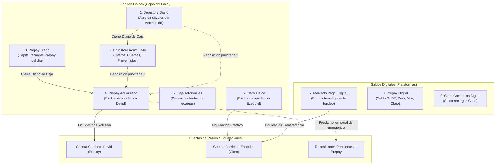
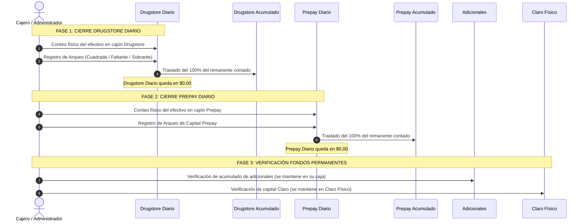

# MANUAL MAESTRO: CIRCUITO ECONÓMICO, MANEJO DEL DINERO Y ARQUITECTURA TÉCNICA
## GENAROPOS V4 — DRUGSTORE Y RECARGAS VIRTUALES

**DOCUMENTO OFICIAL DE DEFINICIÓN DE NEGOCIO Y ARQUITECTURA DE SOFTWARE**  
**PROYECTO:** GenaroPOS V4  
**FECHA DE DOCUMENTACIÓN:** 7 de Noviembre de 2026  
**ESTADO:** COMPLETO, AUDITADO Y CERTIFICADO EN PRODUCCIÓN  
**RAMA:** `feature/staging-central-accounting` | **COMMIT:** `f2b90e4`

---

## 1. INTRODUCCIÓN Y REGLA DE ORO DEL NEGOCIO

El Drugstore combina dos modelos de actividad simultáneos en el mismo punto de venta:
1. **Comercialización de Mercadería (Kiosco / Almacén):** Venta de productos tradicionales en efectivo o por medios digitales, donde el ingreso neto pertenece a la recaudación operativa del comercio.
2. **Prestación de Servicios de Recargas Virtuales:** Cobro y acreditación de saldo digital sobre cuatro servicios esenciales: **SUBE, Personal, Movistar y Claro**.

### La Regla de Oro del Negocio
> **"Cada peso tiene un origen, una ubicación física o digital identificable y un destino obligatorio inalterable."**  
> El efectivo de Drugstore no se mezcla con el capital de recargas, el capital de Prepay no se mezcla con el capital de Claro, las cuentas digitales no se confunden con el dinero físico, y las ganancias por comisiones (adicionales) se apartan en una caja independiente.

---

## 2. DIFERENCIACIÓN OBLIGATORIA: CAPITAL VS. ADICIONAL

En toda operación de recarga virtual conviven dos componentes con finalidades económicas radicalmente opuestas:

```
┌────────────────────────────────────────────────────────────────────────┐
│                   TOTAL COBRADO AL CLIENTE ($10.500)                   │
├──────────────────────────────────┬─────────────────────────────────────┤
│      CAPITAL DE RECARGA          │         ADICIONAL / COMISIÓN        │
│           ($10.000)              │                ($500)               │
├──────────────────────────────────┼─────────────────────────────────────┤
│ • NO es ganancia del negocio.     │ • SÍ es ganancia líquida del negocio│
│ • Es reposición de saldo digital.│ • Se deposita en caja "Adicionales".│
│ • Pertenece a la plataforma      │ • No se entrega a los proveedores   │
│   (Prepay o Claro Comercios).    │   de saldo digital.                 │
│ • Debe ingresar a la caja física │ • Permanece segregado de la caja    │
│   del circuito correspondiente.  │   diaria y del capital.             │
└──────────────────────────────────┴─────────────────────────────────────┘
```

---

## 3. MAPA INTEGRAL DE FONDOS: FÍSICOS Y DIGITALES

El sistema administra **6 fondos físicos independientes** y **3 saldos digitales**, complementados con **3 cuentas de pasivo / seguimiento de liquidación**.



### 3.1. Detalle de Fondos Físicos

1. **Drugstore Diario (`1110` en el sistema):**
   - Comienza cada jornada estrictamente en **$0**.
   - Concentra el efectivo de ventas de mercadería y entradas operativas directas de Drugstore.
   - Al cerrar la jornada, el 100% del efectivo remanente se traslada a Drugstore Acumulado (`1120`).
2. **Drugstore Acumulado o General (`1120`):**
   - Es el reservorio de liquidez operativa del comercio.
   - Destinos autorizados: pago de proveedores comerciales, facturas de servicios del local, gastos generales, reposición de préstamos tomados de Prepay y retiros del titular.
3. **Prepay Diario (`1160`):**
   - Comienza cada jornada en **$0**.
   - Recibe el capital en efectivo de las recargas realizadas a través de la plataforma Prepay (SUBE, Personal, Movistar, Claro) o la compensación en efectivo proveniente de Drugstore cuando el cliente paga por transferencia.
   - **Prohibición absoluta:** Nunca debe mezclarse con la caja de Drugstore Diario ni absorberse en el fondo general del negocio.
   - Al finalizar la jornada, se cuenta el dinero físico remanente y se traslada íntegramente a Prepay Acumulado (`1130`).
4. **Prepay Acumulado (`1130`):**
   - Fondo físico donde se concentra el capital histórico acumulado de Prepay.
   - **Destino prioritario y excluyente:** Liquidaciones presenciales con David.
   - Excepción controlada: Se puede utilizar de forma temporal para pagar preventistas cuando Drugstore carece de efectivo, generando automáticamente un pasivo interno por reponer.
5. **Caja de Adicionales (`1140`):**
   - Caja física independiente donde se depositan los adicionales cobrados en todas las recargas (SUBE, Personal, Movistar, Claro).
   - Representa la ganancia real y neta del servicio de recargas. No se entrega a David ni a Ezequiel.
6. **Claro Físico (`1150`):**
   - Caja física destinada exclusivamente al capital de las recargas procesadas en Claro Comercios.
   - Se destina a la liquidación periódica con Ezequiel.

### 3.2. Detalle de Saldos Digitales

7. **Mercado Pago (`1210`):**
   - Billetera virtual que recibe las transferencias de clientes (ventas y recargas).
   - Permite realizar transferencias puente hacia proveedores (Ezequiel) o fondeo bancario.
8. **Prepay Digital (`1220`):**
   - Saldo digital disponible para emitir recargas en el portal Prepay.
   - Acreditado mediante transferencias enviadas por David. Se consume con cada recarga emitida y con el cargo diario de mantenimiento.
9. **Claro Comercios Digital (`1230`):**
   - Saldo digital disponible en la plataforma Claro Comercios para recargas directas Claro.
   - Rango objetivo de mantenimiento: entre **$25.000 y $35.000**. Acreditado por Ezequiel.

---

## 4. MATRIZ DE OPERACIONES Y TRATAMIENTO DEL DINERO

### 4.1. Venta de Mercadería (Kiosco tradicional)
- **Cobro en Efectivo:** Ingresa al 100% en **Drugstore Diario**.
- **Cobro por Transferencia:** Ingresa al 100% en la cuenta digital **Mercado Pago**.

---

### 4.2. Recargas Prepay (SUBE, Personal, Movistar, Claro vía Prepay)

#### Caso A: Cliente paga en Efectivo ($10.500 = $10.000 recarga + $500 adicional)
1. Se debita el saldo en **Prepay Digital** por **-$10.000**.
2. Los **$10.000 de capital ingresan físicamente a Prepay Diario**. (Nunca a Drugstore Diario).
3. Los **$500 de adicional ingresan a la caja de Adicionales**.
4. Al cierre del turno, los $10.000 pasan de Prepay Diario a Prepay Acumulado.

#### Caso B: Cliente paga mediante Transferencia ($10.500)
1. El cliente transfiere **$10.500 a Mercado Pago**.
2. Se debita el saldo en **Prepay Digital** por **-$10.000**.
3. **Mecanismo de Compensación Inmediata de Capital:** Se retiran físicamente **$10.000 en efectivo de la caja de Drugstore** y se ingresan a **Prepay Diario**.
4. Los **$500 de adicional** se imputan a la ganancia de Adicionales.
5. *Resultado:* Prepay recibe el efectivo físico que respalda el capital digital consumido, quedando listo para liquidar con David.

---

### 4.3. Recargas Claro Comercios (Vía plataforma Claro)

#### Caso A: Cliente paga en Efectivo ($10.500)
1. Se debita el saldo en **Claro Comercios Digital** por **-$10.000**.
2. Los **$10.000 de capital ingresan a Claro Físico**.
3. Los **$500 de adicional ingresan a la caja de Adicionales**.

#### Caso B: Cliente paga por Transferencia ($10.500)
1. El dinero ingresa a **Mercado Pago**.
2. Se debita el saldo en **Claro Comercios Digital** por **-$10.000**.
3. Se traslada el equivalente de **$10.000 en efectivo desde Drugstore hacia Claro Físico**.
4. El adicional se acredita a **Adicionales**.

---

### 4.4. Recargas Directas desde Mercado Pago
- Esta modalidad utiliza el saldo digital propio de la cuenta Mercado Pago del comercio.
- **Si el cliente paga en efectivo:** Disminuye el saldo digital de Mercado Pago y el efectivo que entrega el cliente ingresa a **Drugstore Diario**. Se produce un canje directo de saldo digital por efectivo físico dentro de Drugstore.
- **Impacto en proveedores:** **Cero**. No afecta a Prepay, no afecta a Claro Comercios, no altera las cajas Prepay ni Claro Físico, y no genera deudas con David ni con Ezequiel.
- **El adicional:** Se separa en la caja de **Adicionales**.

---

### 4.5. Cargo Diario de Mantenimiento Prepay ($350)
- Prepay descuenta un costo de uso de plataforma de **$350 por día calendario**.
- **Mecanismo de débito:** Se debita automáticamente del **saldo digital de Prepay** con la primera recarga del día.
- **Naturaleza contable:** Es un **gasto operativo general del negocio**.
- **Regla estricta:**
  - **NO** se descuenta de Mercado Pago ni de Claro Comercios.
  - **NO** se descuenta del efectivo físico de Prepay Diario ni de Prepay Acumulado.
  - **NO** se descuenta de la caja de Adicionales.
  - **NO** altera el capital exigible por David (es absorbido por los resultados del negocio).

---

## 5. PROVEEDORES, LIQUIDACIONES Y REGLAS DE EXTINCIÓN DE DEUDA

### 5.1. Proveedor David (Circuito Prepay)
- **Función:** Provee recargas de saldo digital en Prepay mediante transferencias.
- **Registro de la deuda:** Cuando David acredita saldo (ej. $100.000), se incrementa Prepay Digital y se incrementa el pasivo con David en la cuenta corriente.
- **Regla de Liquidación:**
  1. Se liquida **única y exclusivamente con el efectivo acumulado en Prepay Acumulado**.
  2. **Está terminantemente prohibido pagarle a David directamente con efectivo de Drugstore Diario o Drugstore Acumulado.**
  3. Si en el momento de la visita el efectivo disponible en Prepay Acumulado es inferior a la deuda acumulada, se realiza un **pago parcial** por el monto exacto disponible. El saldo impago queda pendiente para la siguiente visita.
  4. Si parte del dinero de Prepay fue prestado a preventistas, dicho monto debe reponerse antes de cancelar la totalidad de la deuda.

### 5.2. Proveedor Ezequiel (Circuito Claro Comercios)
- **Función:** Asiste presencialmente al comercio, carga saldo digital en Claro Comercios y coordina la liquidación.
- **Modalidad Multifondo (Efectivo + Transferencia):**
  - Ezequiel puede recibir parte de su pago mediante transferencia digital desde **Mercado Pago** y el resto en efectivo desde **Claro Físico**.
  - *Ejemplo:* Liquidación de $15.000 -> $5.000 transferidos desde Mercado Pago y $10.000 entregados en efectivo desde Claro Físico.
- **Regla de Excepción de Fondos:**
  - Si en Claro Físico no hay efectivo suficiente para liquidar, **se autoriza excepcionalmente completar el pago con dinero de Drugstore Acumulado**, siempre que exista disponibilidad real.
  - Si tampoco hubiera liquidez en Drugstore, la diferencia permanece como pasivo pendiente en la cuenta de Ezequiel.

### 5.3. Préstamos Temporales a Preventistas con Fondos de Prepay
Cuando el Drugstore no cuenta con efectivo suficiente para abonar facturas críticas a preventistas de mercadería:
1. **Extracción Temporal:** Se permite retirar efectivo de **Prepay Acumulado**.
2. **Generación del Anticipo / Préstamo:** Se registra un débito en Prepay y un crédito de pasivo interno denominado **"Reposición Pendiente a Prepay"**. No se imputa como liquidación a David.
3. **Casada de Reposición Prioritaria:**
   - **Prioridad 1:** Se repone en cuanto haya liquidez desde **Drugstore Acumulado**.
   - **Prioridad 2:** Si Drugstore Acumulado no alcanza, se repone con el remanente de **Drugstore Diario**.
   - **Prioridad 3:** Si persiste saldo impago, se arrastra como obligación interna hasta su total compensación.

---

## 6. PROTOCOLO DE CIERRE DIARIO Y ARQUEO FÍSICO

Al terminar cada turno de atención en el local, se ejecuta la rutina de cierre independiente:



---

## 7. MAPEO TÉCNICO EN LA ARQUITECTURA DE GENAROPOS V4

### 7.1. Esquema de Base de Datos y Catálogo de Cuentas

En las bases SQLite / libSQL de GenaroPOS V4, la tesorería está modelada mediante el estándar de partida doble y auditoría append-only:

| Código | Nombre Canónico | Tipo | Categoría | Propósito en el Negocio |
|:------:|-----------------|:----:|:---------:|-------------------------|
| `1110` | **Drugstore Diario** | ACTIVO | Físico | Caja operativa diaria de mercadería. Abre en 0, cierra a 1120. |
| `1120` | **Drugstore Acumulado** | ACTIVO | Físico | Fondo general de reserva. Paga gastos, cuentas y reposiciones. |
| `1160` | **Prepay Diario** | ACTIVO | Físico | Capital de recargas Prepay del día. Abre en 0, cierra a 1130. |
| `1130` | **Prepay Acumulado** | ACTIVO | Físico | Capital histórico Prepay. Destinado a liquidar con David. |
| `1140` | **Caja de Adicionales** | ACTIVO | Físico | Ganancias por comisiones de recargas (SUBE/Personal/Mov/Claro). |
| `1150` | **Claro Físico** | ACTIVO | Físico | Capital de recargas Claro Comercios para liquidar con Ezequiel. |
| `1210` | **Mercado Pago Digital**| ACTIVO | Digital | Saldo en cuenta virtual Mercado Pago. |
| `1220` | **Prepay Digital** | ACTIVO | Digital | Saldo en portal Prepay para emitir recargas. |
| `1230` | **Claro Digital** | ACTIVO | Digital | Saldo en portal Claro Comercios. |
| `1310` | **Cobranzas en Tránsito**| ACTIVO | Transitorio | Anticipos transitorios a preventistas. |
| `2110` | **Cuenta Corriente David**| PASIVO | Deuda Proveedor | Pasivo exigible por cargas Prepay recibidas. |
| `2120` | **Cuenta Corriente Ezequiel**| PASIVO | Deuda Proveedor | Pasivo exigible por cargas Claro Comercios. |
| `2130` | **Anticipos Preventistas Prepay** | PASIVO / REGULADORA | Deuda Interna | Control de fondos Prepay prestados transitoriamente a compras. |

### 7.2. Tablas del Motor de Tesorería (`tesoreria.db`)
- `tesoreria_fondos`: Catálogo de las cuentas anteriores con balance en centavos enteros (`cents`).
- `tesoreria_movimientos`: Libro diario inmutable (`ENTRY`, `EXIT`, `TRANSFER`, `SETTLEMENT`) con idempotencia y usuario atribuidor (`alan`/`yilda`).
- `tesoreria_jornadas`: Control del ciclo de apertura y cierre diario.
- `tesoreria_arqueos`: Registro del conteo físico ciego/asistido, registrando diferencias.
- `tesoreria_cierres`: Snapshot criptográfico SHA-256 de estados de fondos al cierre de turno.
- `tesoreria_traslados`: Envíos formales entre cajas con doble confirmación.
- `tesoreria_anticipos_preventistas`: Control individual de préstamos temporales de Prepay a preventistas.
- `tesoreria_cuenta_corriente_david` y `tesoreria_cuenta_corriente_ezequiel`: Subdiarios de liquidación de proveedores.
- `tesoreria_aperturas_iniciales`: Registro de saldos iniciales del corte histórico sin movimientos ficticios.

### 7.3. Integración Comercial y Outbox Pattern (`genaro-pos.db`)
- `commercial_events_outbox`: Cola persistente transaccional que emite eventos (`TICKET_CREATED`, `EXPENSE_CREATED`, `SERVICE_RELOAD_CREATED`) de manera atómica con la venta, asegurando sincronización idempotente hacia Turso Cloud y Worker Edge.

---

## 8. APERTURA ECONÓMICA MANUAL DIFERIDA (ESTADO ACTUAL)

Conforme a la decisión expresa del propietario:
1. **Estado Actual:** El software está 100% operativo y desplegado en producción, manteniendo los fondos en estado **`PENDIENTE_DE_APERTURA`**.
2. **Cero Ficción Contable:** No se asignaron saldos iniciales en cero ficticios ni se inventaron cifras.
3. **Procedimiento de Activación por el Titular:**
   - Acceder a **GenaroPOS -> Tesorería -> Pestaña "Aperturas"** (`tab-aperturas`).
   - Hacer clic en **"Configurar Apertura"** en el fondo deseado.
   - Ingresar el conteo real físico en billetes o saldo de la plataforma a la fecha de corte.
   - Al confirmar, el sistema asienta el saldo inicial de forma inmutable y habilita las validaciones de disponibilidad del fondo.

---

## 9. TOPOLOGÍA DE SERVICIOS Y ACCESOS PRODUCTIVOS

| Servicio / Destino | Protocolo / URL | Ruta en Servidor | Función |
|--------------------|-----------------|------------------|---------|
| **Frontend Cloudflare** | `https://genaro-pos-live.pages.dev` | Cloudflare Pages CDN | Acceso global web para mostrador y administración móvil |
| **Frontend Local Caddy** | `http://127.0.0.1:8080` | `/home/alanrod10/production/www` | Servidor local ultra-rápido en la máquina de caja |
| **Backend Local FastAPI**| `http://127.0.0.1:8000` | `/home/alanrod10/production/app` | API central REST, lógica financiera y persistencia SQLite |
| **Worker Cloudflare Live**| `https://genaro-pos-live-api.genaro-pos.workers.dev` | Cloudflare Workers | Gateway de alta disponibilidad y réplica libSQL |
| **Base de Datos Cloud** | Turso AWS sa-east-1 (`genaro-pos-live-ops`) | Turso Cloud | Base de datos sincronizada de alta resiliencia |

---

## 10. PROCEDIMIENTO DE CONTINGENCIA Y ROLLBACK

Si se requiriese retornar al punto de restauración previo a las actualizaciones:
- **Respaldo Local Inmaculado:**
  ```bash
  rm -rf /home/alanrod10/production/www/*
  cp -r /home/alanrod10/production/backups/www_backup_20261107_033538/* /home/alanrod10/production/www/
  ```
- **Rollback en Cloudflare Pages:**
  ```bash
  npx wrangler pages deploy /home/alanrod10/production/backups/www_backup_20261107_033538 --project-name=genaro-pos-live --branch=main
  ```

---
*Fin del Manual Maestro — GenaroPOS V4. Registrado y protegido para el cierre de jornada del 7 de Noviembre de 2026.*
