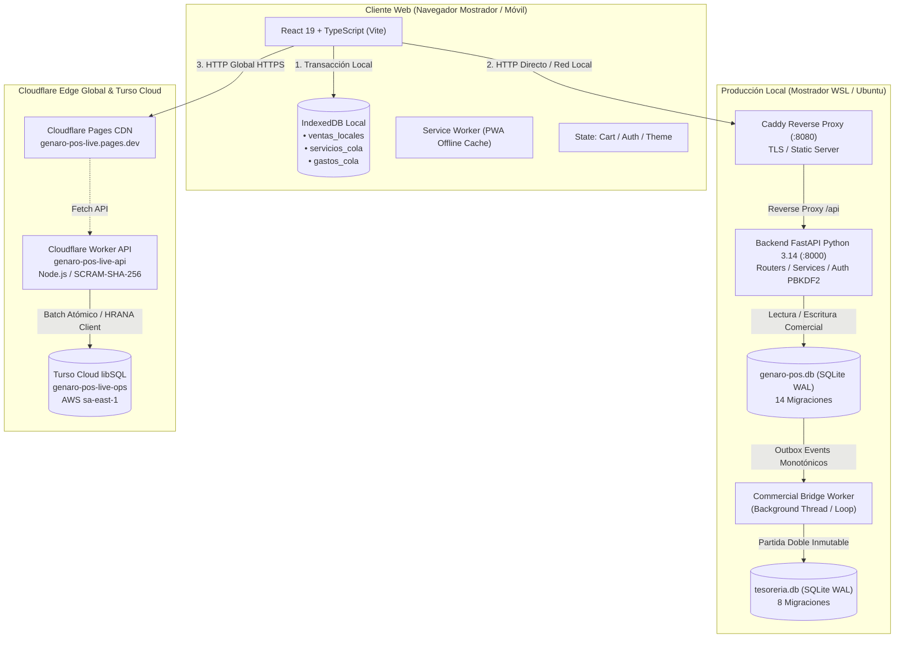
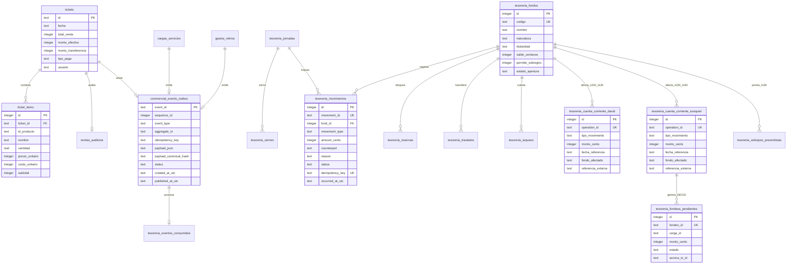
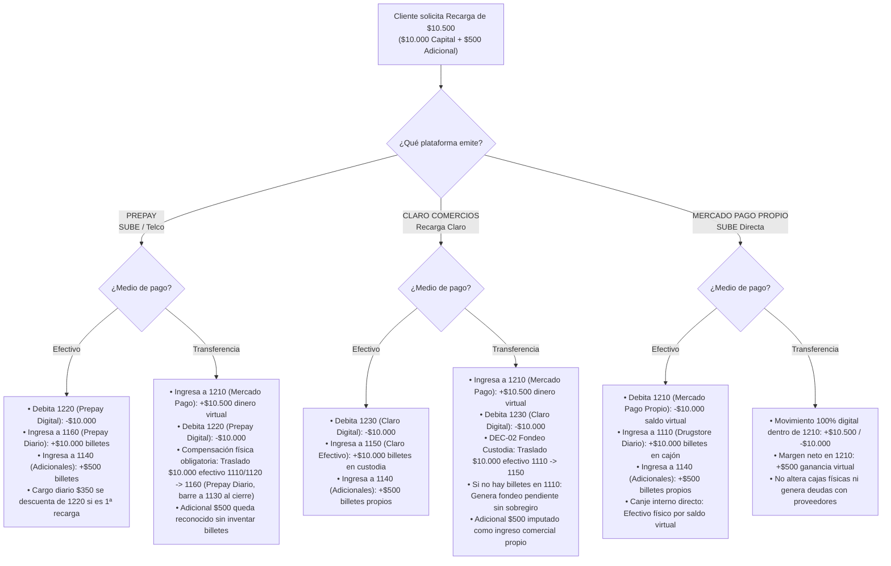
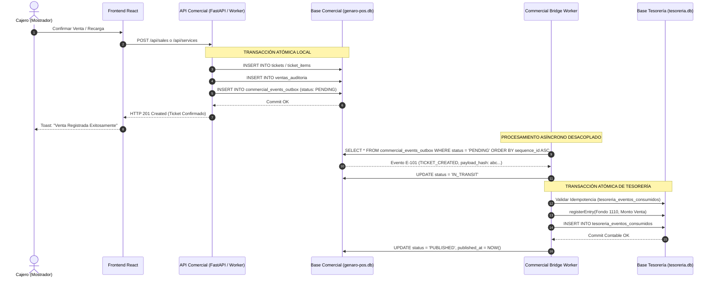

# CONTEXTO MAESTRO INTEGRAL DE INGENIERÍA DE SOFTWARE — GENAROPOS V4
# BASE DE CONOCIMIENTO TÉCNICA, ARQUITECTÓNICA, FUNCIONAL, ECONÓMICA Y OPERATIVA PARA AGENTES DE INTELIGENCIA ARTIFICIAL

> **PROPÓSITO DEL DOCUMENTO:**  
> Este documento constituye la memoria técnica y arquitectónica definitiva de **GenaroPOS V4**. Ha sido redactado para que cualquier agente de inteligencia artificial, arquitecto de software, ingeniero de confiabilidad (SRE), desarrollador senior o auditor de sistemas pueda asumir de inmediato tareas de mantenimiento, resolución de incidentes, auditoría transaccional y evolución del sistema **con total autonomía técnica, máxima fidelidad a la realidad del código y sin depender de memoria conversacional previa**.
> 
> **ESTADO DE VERIFICACIÓN:** Contrastado exhaustivamente contra el código fuente, esquemas DDL, migraciones, pruebas automatizadas y despliegues en vivo al **7 de Noviembre de 2026**.

---

## ÍNDICE GENERAL SISTEMÁTICO

1. [Identidad del Relevamiento e Integridad Git](#1-identidad-del-relevamiento-e-integridad-git)
2. [Identidad, Propósito y Descripción General del Negocio](#2-identidad-propósito-y-descripción-general-del-negocio)
3. [Arquitectura General del Sistema y Topología de Ejecución](#3-arquitectura-general-del-sistema-y-topología-de-ejecución)
4. [Mapa Completo del Repositorio e Inventario de Archivos Críticos](#4-mapa-completo-del-repositorio-e-inventario-de-archivos-críticos)
5. [Frontend — Mapa Funcional, Componentes y Ergonomía](#5-frontend--mapa-funcional-componentes-y-ergonomía)
6. [Backend — Catálogo Completo de Endpoints y Servicios](#6-backend--catálogo-completo-de-endpoints-y-servicios)
7. [Cloudflare Worker — API Edge y Acceso a Turso libSQL](#7-cloudflare-worker--api-edge-y-acceso-a-turso-libsql)
8. [Modelo de Persistencia, Bases de Datos y Migraciones](#8-modelo-de-persistencia-bases-de-datos-y-migraciones)
9. [El Circuito Económico Real y las Reglas de Manejo del Dinero](#9-el-circuito-económico-real-y-las-reglas-de-manejo-del-dinero)
10. [Tesorería Central, Partida Doble y Libro Mayor Inmutable](#10-tesorería-central-partida-doble-y-libro-mayor-inmutable)
11. [Cuentas Corrientes de Proveedores, Pasivos y Liquidaciones](#11-cuentas-corrientes-de-proveedores-pasivos-y-liquidaciones)
12. [Sistema Outbox, Commercial Bridge y Sincronización](#12-sistema-outbox-commercial-bridge-y-sincronización)
13. [Apertura Económica Diferida Manual (Estado Actual PENDING_OPENING)](#13-apertura-económica-diferida-manual-estado-actual-pending_opening)
14. [Autenticación, Seguridad Criptográfica y Roles](#14-autenticación-seguridad-criptográfica-y-roles)
15. [Infraestructura, Topología de Red y Procedimientos de Despliegue](#15-infraestructura-topología-de-red-y-procedimientos-de-despliegue)
16. [UX/UI, Accesibilidad de Mostrador y Auditoría de Fase V](#16-uxui-accesibilidad-de-mostrador-y-auditoría-de-fase-v)
17. [Garantía de Calidad y Matriz de Pruebas Automatizadas](#17-garantía-de-calidad-y-matriz-de-pruebas-automatizadas)
18. [Manual de Procedimientos Técnicos y Operativos](#18-manual-de-procedimientos-técnicos-y-operativos)
19. [Historial Forense de Incidentes y Lecciones Aprendidas](#19-historial-forense-de-incidentes-y-lecciones-aprendidas)
20. [Reglas Obligatorias de Ingeniería para Futuras Inteligencias Artificiales](#20-reglas-obligatorias-de-ingeniería-para-futuras-inteligencias-artificiales)
21. [Estado Actual del Sistema, Limitaciones y Deuda Técnica](#21-estado-actual-del-sistema-limitaciones-y-deuda-técnica)
22. [Glosario Canónico Técnico y Financiero](#22-glosario-canónico-técnico-y-financiero)
23. [Índice de Fuentes y Referencias del Repositorio](#23-índice-de-fuentes-y-referencias-del-repositorio)

---

## 1. IDENTIDAD DEL RELEVAMIENTO E INTEGRIDAD GIT

El presente relevamiento técnico fue ejecutado directamente sobre el repositorio físico en entorno WSL Linux el día **7 de Noviembre de 2026**.

### 1.1 Coordenadas de Localización
- **Ruta WSL (Linux):** `/home/alanrod10/workspace/genaro-pos-turso-lab`
- **Ruta Windows (UNC):** `\\wsl.localhost\Ubuntu\home\alanrod10\workspace\genaro-pos-turso-lab`
- **Propietario del Sistema:** Alan Rodrigo Bustamante
- **Entorno de Producción Local:** `/home/alanrod10/production/app` (Backend) y `/home/alanrod10/production/www` (Frontend Caddy)

### 1.2 Estado Git al Momento del Relevamiento
- **Rama Activa:** `feature/staging-central-accounting`
- **Commit HEAD:** `58ccae17e153d87c49a64a1d91401c9559ac1932`
- **Mensaje de HEAD:** `docs: consolidar informes tecnicos de fase v y manual maestro en carpeta docs del proyecto`
- **Commit Anterior:** `2df5304274b93a2c93bc8995340eb9c0ac01384f` (`docs(master): manual maestro definitivo de circuito economico y manejo del dinero de drugstore y recargas v4`)
- **Working Tree:** `clean` (0 archivos sin commitear, working tree inmaculado).

### 1.3 Registro de Commits Clave del Historial Reciente
| Commit Hash | Autor | Fecha | Mensaje / Hito Arquitectónico |
|---|---|---|---|
| `58ccae1` | Alan Bustamante | 2026-11-07 03:48 UTC | Consolidación de manuales maestros e informes de Fase V en carpeta `docs/`. |
| `2df5304` | Alan Bustamante | 2026-11-07 03:46 UTC | Manual maestro definitivo de circuito económico y manejo de fondos V4. |
| `f2b90e4` | Alan Bustamante | 2026-11-07 03:39 UTC | Verificación en vivo post-deploy y evidencia de navegador CDP. |
| `59b0bc3` | Alan Bustamante | 2026-11-07 03:34 UTC | Merge de mejoras de calidad UX/UI, ergonomía y accesibilidad de Fase V. |
| `cddc3f2` | Alan Bustamante | 2026-11-07 03:32 UTC | Commit de origen de Fase V (`feature/fase-v-quality-ux-ui`): 305 botones auditados, Esc listeners, ARIA. |
| `d6fba55` | Alan Bustamante | 2026-11-07 03:09 UTC | Informe técnico de resolución de incidente P0 de Outbox en Turso Cloud. |
| `7f7c3a2` | Alan Bustamante | 2026-11-07 03:08 UTC | Suite de 12 pruebas de recuperación de persistencia y Outbox comercial (`test_p0_...`). |
| `1c48b28` | Alan Bustamante | 2026-11-07 02:47 UTC | Informe de despliegue y apertura diferida en producción. |
| `3b53e89` | Alan Bustamante | 2026-11-07 02:43 UTC | Implementación completa de apertura económica diferida manual (`PENDING_OPENING`) y migración 008. |
| `474601d` | Alan Bustamante | 2026-11-06 19:53 UTC | Certificación y liberación técnica Etapa IV (`771 pytests`, `383 vitests`, `64 worker tests`). |
| `f592ea8` | Alan Bustamante | 2026-11-06 19:40 UTC | Consolidación económica integral, CC Ezequiel, fondeo DEC-02 y migración 007. |
| `17ec293` | Alan Bustamante | 2026-11-06 14:03 UTC | Despliegue oficial inicial en `genaro-pos-live` (producción v4 baseline). |

---

## 2. IDENTIDAD, PROPÓSITO Y DESCRIPCIÓN GENERAL DEL NEGOCIO

### 2.1 ¿Qué es GenaroPOS V4?
GenaroPOS V4 es una plataforma de **Punto de Venta (POS) y Tesorería Centralizada de Alta Precisión**, diseñada y construida a medida para la operación integral de un Drugstore / Kiosco / Almacén de alta rotación con servicios virtuales y cobros digitales concurrentes.

A diferencia de un software de punto de venta convencional —que simplemente descuenta stock y registra un número de facturación—, GenaroPOS V4 resuelve la convivencia de **dos actividades económicas simultáneas** en un mismo mostrador:
1. **Comercialización de Mercadería Tradicional:** Venta de golosinas, bebidas, almacén, cigarrillos y artículos pesables, cobrados en efectivo, billeteras digitales (Mercado Pago / transferencias bancarias) o modalidades mixtas.
2. **Intermediación Financiera de Servicios Virtuales y Recargas:** Cobro de recargas de transporte público (**SUBE**) y telefonía móvil (**Claro, Movistar, Personal**) operadas a través de plataformas mayoristas externas (**PREPAY** y **Claro Comercios**).

### 2.2 Resumen Ejecutivo para un Nuevo Agente de IA (Comprensión en 5 Minutos)
```
┌────────────────────────────────────────────────────────────────────────────────────────┐
│                                   GENAROPOS V4 EN 5 MINUTOS                            │
├────────────────────────────────────────────────────────────────────────────────────────┤
│ 1. REGLA FUNDAMENTAL: El capital de recargas NO es ganancia del negocio.              │
│    El negocio retiene una comisión propia ("Adicional"). El resto es reposición        │
│    obligatoria de saldo digital mayorista a los proveedores (David y Ezequiel).        │
│                                                                                        │
│ 2. ARQUITECTURA DUAL DE PERSISTENCIA:                                                  │
│    - Base Comercial (genaro-pos.db): Productos, Tickets, Cargas, Gastos, Outbox.       │
│    - Base Tesorería (tesoreria.db): 10 Fondos canónicos, Partida Doble, Cierres, CC.   │
│    - Base Cloud (Turso libSQL): Réplica transaccional remota operada por Edge Worker.  │
│                                                                                        │
│ 3. PUENTE ASÍNCRONO DE INTEGRACIÓN (Outbox + Commercial Bridge):                       │
│    Una venta o recarga en el mostrador impacta la base comercial y genera un evento    │
│    atómico en `commercial_events_outbox`. El Commercial Bridge Worker consume el       │
│    evento de forma asíncrona e inmutable y asienta el movimiento en Tesorería.         │
│                                                                                        │
│ 4. DISPONIBILIDAD Y APERTURA ECONÓMICA:                                                │
│    El sistema opera bajo el estado formal `PENDING_OPENING` (Apertura Diferida).       │
│    No se asumen saldos en $0 ni importes inventados. Las operaciones comerciales       │
│    entrantes funcionan con total libertad; los egresos y liquidaciones de deuda        │
│    requieren que el propietario asiente el saldo real mediante la interfaz de corte.   │
│                                                                                        │
│ 5. SEGURIDAD FAIL-CLOSED:                                                              │
│    Autenticación SCRAM-SHA-256 en Edge y PBKDF2 en local. Acceso exclusivo para        │
│    los socios Alan y Yilda. Los clientes no autenticados quedan en modo demo aislado.  │
└────────────────────────────────────────────────────────────────────────────────────────┘
```

### 2.3 Actores y Usuarios del Sistema
- **Alan (Socio / Administrador General):** Titular de la operación comercial y financiera. Realiza compras, arqueos, aperturas de fondos, liquidaciones con David y Ezequiel, y control técnico.
- **Yilda (Socia / Administradora):** Titular de mostrador y administración. Opera ventas, servicios, gastos operativos y cierres de jornada.
- **David (Proveedor Mayorista PREPAY):** Provee saldo digital para recargas de SUBE, Personal, Movistar y Claro vía el portal mayorista PREPAY. Se liquida presencialmente en efectivo físico acumulado.
- **Ezequiel (Proveedor Mayorista Claro Comercios):** Distribuidor presencial de saldo para la plataforma Claro Comercios. Se liquida de forma multifondo (efectivo en custodia Claro, efectivo Drugstore y/o transferencia digital).
- **Preventistas (Proveedores Comerciales):** Distribuidores de mercadería física (golosinas, bebidas, lácteos) que visitan el local para tomar pedidos y cobrar facturas al contado o a plazo.

---

## 3. ARQUITECTURA GENERAL DEL SISTEMA Y TOPOLOGÍA DE EJECUCIÓN

GenaroPOS V4 está diseñado bajo una arquitectura desacoplada, híbrida y tolerante a fallos de conectividad (offline-first).



### 3.1 El Frontend (Single Page Application)
- **Framework:** React 19 con TypeScript 5.6 y Vite 6.4.5.
- **Estilos:** TailwindCSS con paleta cromática semántica dual: *Midnight Terracotta* (Oscuro) y *Warm Ivory* (Claro).
- **Almacenamiento del Cliente (Offline-First):** Motor [`frontend/src/services/db.ts`](file:///home/alanrod10/workspace/genaro-pos-turso-lab/frontend/src/services/db.ts) sobre **IndexedDB**, con las siguientes almacenes:
  - `ventas_locales`: Ventas retenidas localmente pendientes de confirmación o en modo offline.
  - `servicios_cola`: Recargas virtuales pendientes de transmisión.
  - `gastos_cola`: Egresos registrados pendientes de sincronización.
  - `ventas_demo`: Espacio de aislamiento transaccional para simulaciones sin autenticación.
  - `catalogo_cache`: Snapshot del catálogo de mercadería para operación sin internet.

### 3.2 El Backend FastAPI (Motor Local de Mostrador)
- **Lenguaje y Runtime:** Python 3.14 corriendo bajo virtualenv aislado.
- **Servidor ASGI:** Uvicorn escuchando estrictamente en loopback `127.0.0.1:8000`.
- **Estructura Arquitectónica:** Clean Architecture desacoplada en:
  - `api/routers/`: Controladores REST con validación Pydantic, rate-limiting y RBAC.
  - `tesoreria/`: Motor de dominio financiero puro, inmutable, auditable y con aislamiento de fondos.
  - `db/`: Capa de repositorios y emisores transaccionales (`commercial_outbox_emitter.py`).

### 3.3 El Cloudflare Worker (Gateway Edge Global)
- **Runtime:** Cloudflare Workers con compatibilidad Node.js (`compatibility_flags = ["nodejs_compat"]`).
- **Punto de Entrada:** `experiments/cloudflare-worker-prototype/src/worker.js`.
- **Capa de Base de Datos:** Cliente oficial `@libsql/client` (protocolo HRANA sobre WebSocket/HTTP) conectado a Turso Cloud (`genaro-pos-live-ops`).
- **Seguridad Edge:** Implementación pura de **SCRAM-SHA-256** (RFC 5802 / RFC 7677) en Web Crypto, diseñada para ejecución sub-10ms.

---

## 4. MAPA COMPLETO DEL REPOSITORIO E INVENTARIO DE ARCHIVOS CRÍTICOS

### 4.1 Árbol Estructural Jerárquico
```text
/home/alanrod10/workspace/genaro-pos-turso-lab/
├── api/                           # Backend FastAPI: routers, esquemas y autenticación
│   ├── main.py                    # Punto de entrada de la aplicación FastAPI y lifespan
│   ├── auth.py                    # Lógica de seguridad PBKDF2 y JWT
│   ├── dependencies.py            # Inyección de dependencias (get_current_user, DB conns)
│   ├── rate_limiter.py            # Limitador de tasa contra ataques de fuerza bruta
│   ├── schemas.py                 # Esquemas Pydantic v2 de entrada y salida
│   └── routers/                   # Enrutadores modulares organizados por dominio
│       ├── auth.py                # POST /api/auth/login y /me
│       ├── catalog.py             # CRUD de productos y stock
│       ├── sales.py               # Registro y anulación de ventas
│       ├── services.py            # Recargas virtuales (PREPAY, Claro, MP)
│       ├── expenses.py            # Gastos operativos y arqueo de mostrador
│       ├── preventistas.py        # Pedidos y cuentas de distribuidores comerciales
│       ├── reports.py             # Métricas agregadas y dashboard
│       ├── system.py              # Comprobación de salud estructural (Readiness)
│       ├── historical.py          # Auditoría histórica consolidada
│       ├── tesoreria.py           # API REST del Laboratorio de Tesorería Central
│       └── commercial_bridge.py   # Telemetría y control del worker puente
├── db/                            # Persistencia Comercial (genaro-pos.db)
│   ├── migrations/                # 14 Migraciones DDL secuenciales de la base comercial
│   ├── migrations_runner.py       # Ejecutor transaccional de migraciones comerciales
│   ├── commercial_outbox_emitter.py# Emisor determinista de eventos outbox (RFC 8785)
│   ├── readiness.py               # Validador de salud estructural previa al inicio
│   ├── catalog.py                 # Repositorio de productos
│   ├── sales.py                   # Repositorio de ventas y tickets
│   └── services.py                # Repositorio de recargas virtuales
├── tesoreria/                     # Motor Central de Tesorería (tesoreria.db)
│   ├── migrations/                # 8 Migraciones DDL de Tesorería (Fondos, Cierres, CC)
│   ├── migrations_runner.py       # Ejecutor de reconstrucción 12-step para SQLite
│   ├── schema.py                  # DDL base y definición canónica de 10 fondos
│   ├── catalog.py                 # Catálogo de fondos y validaciones de inmutabilidad
│   ├── money.py                   # Aritmética financiera entera en centavos (cents)
│   ├── movements.py               # Registro de entradas, salidas y transferencias
│   ├── availability.py            # Cálculo dinámico de liquidez y detección de sobregiros
│   ├── reservations.py            # Bloqueos y apartados temporales de dinero
│   ├── transfers.py               # Despacho y confirmación de traslados inter-caja
│   ├── closures.py                # Arqueos, cierres diarios y barridos de gaveta
│   ├── prepay_coordinator.py      # Coordinación del cargo diario de $350 y circuito PREPAY
│   ├── cuenta_corriente_david.py  # Subdiario contable proveedor PREPAY (David)
│   ├── cuenta_corriente_ezequiel.py# Subdiario multifondo proveedor Claro (Ezequiel)
│   ├── anticipos_preventistas.py  # Control de préstamos de Prepay para compras
│   ├── aperturas.py               # Gestión de Apertura Diferida Manual (PENDING_OPENING)
│   ├── audit_chain.py             # Pista de auditoría append-only con encadenamiento SHA-256
│   └── commercial_bridge_worker.py# Consumidor asíncrono outbox hacia el libro mayor
├── frontend/                      # Aplicación Web React 19 + TypeScript + Vite
│   ├── src/
│   │   ├── App.tsx                # Orquestador visual principal, navegación y estado
│   │   ├── main.tsx               # Bootstrap de React y montaje de DOM
│   │   ├── index.css              # Reglas globales de estilo y variables temáticas
│   │   ├── components/            # Componentes funcionales y modales
│   │   │   ├── Cart.tsx           # Carrito de compra, ajuste de precios, atajos
│   │   │   ├── PaymentModal.tsx   # Modal de cobro (Efectivo/MP/Mixto) y vuelto
│   │   │   ├── ProductCatalog.tsx # Explorador táctil de productos por categoría
│   │   │   ├── ProductAdmin.tsx   # ABM de catálogo con guardado blindado
│   │   │   ├── ServicesAdmin.tsx  # Interfaz de recargas virtuales y comisiones
│   │   │   ├── ExpensesCashAdmin.tsx # Gastos de caja y arqueo diario
│   │   │   ├── SalesHistoryAdmin.tsx# Historial de comprobantes y cancelaciones
│   │   │   ├── PreventistasAdmin.tsx# Gestión de proveedores de mercadería
│   │   │   ├── DashboardAdmin.tsx # Métricas ejecutivas y gráficos
│   │   │   ├── TesoreriaLab.tsx   # Consola de Tesorería Integral (14 submódulos)
│   │   │   ├── RadarMonitor.tsx   # Monitor de latencia y servicios en vivo
│   │   │   ├── SyncQueueModal.tsx # Visor y reintento de cola IndexedDB
│   │   │   ├── LoginModal.tsx     # Diálogo de autenticación para Alan/Yilda
│   │   │   ├── WeightSaleModal.tsx# Venta fraccionada por peso o por importe
│   │   │   └── Toast.tsx          # Notificaciones toast no intrusivas
│   │   ├── services/              # Clientes de API, base local IndexedDB y temas
│   │   │   ├── api.ts             # Cliente dual (RealApiClient / MockApiClient)
│   │   │   ├── db.ts              # Motor local IndexedDB (ventas_locales, colas)
│   │   │   ├── sync.ts            # Sincronizador de eventos diferidos
│   │   │   ├── tesoreria.ts       # Cliente REST completo de Tesorería
│   │   │   └── theme.ts           # Motor de tema oscuro/claro persistente
│   │   └── types/                 # Definiciones de tipos TypeScript estrictas
│   └── tests/                     # 40 archivos de prueba unitaria e integración Vitest
├── experiments/cloudflare-worker-prototype/ # Implementación Cloudflare Edge Worker
│   ├── src/
│   │   ├── worker.js              # Fetch handler de Cloudflare Worker
│   │   ├── api/router.js          # Enrutador HTTP unificado (42 endpoints)
│   │   ├── auth/scram.js          # Motor Web Crypto SCRAM-SHA-256
│   │   └── db/
│   │       ├── adapter.js         # Adaptador Turso libSQL para operaciones POS
│   │       └── tesoreria_worker.js# Adaptador Turso libSQL para Tesorería
│   └── tests/                     # 64 pruebas con Node.js Test Runner
├── production/                    # Herramientas y scripts de despliegue productivo
│   ├── deploy_production_bridge.py# Despliegue con verificación Dry-Run y aislamiento
│   ├── rollback_production_bridge.py# Script de reversión atómica ante contingencias
│   └── dia_d_apertura_fondos.py   # Asistente por consola para apertura inicial
├── docs/                          # Documentación técnica maestra y reportes certificados
├── evidencias/                    # Capturas fotográficas de navegadores reales (Fase V)
├── scripts/                       # Scripts auxiliares de diagnóstico y verificación
└── tests/                         # Suite de 793 pruebas Pytest del backend
```

### 4.2 Catálogo de Archivos de Máxima Criticidad
| Archivo | Responsabilidad Central | Funciones Relevantes | Dependencias | Criticidad |
|---|---|---|---|:---:|
| [`tesoreria/catalog.py`](file:///home/alanrod10/workspace/genaro-pos-turso-lab/tesoreria/catalog.py) | Catálogo oficial de los 10 fondos de tesorería, invariantes y protección contra borrado. | `sembrar_catalogo_canónico`, `obtener_fondo_por_codigo`, `validar_invariantes_catalogo` | `tesoreria.isolation`, `tesoreria.money` | **CRÍTICA P0** |
| [`tesoreria/commercial_bridge_worker.py`](file:///home/alanrod10/workspace/genaro-pos-turso-lab/tesoreria/commercial_bridge_worker.py) | Puente asíncrono que transforma eventos comerciales en asientos contables. | `drain_commercial_outbox`, `_procesar_evento_comercial`, `_contabilizar_recarga_servicio` | `db.commercial_outbox_emitter`, `tesoreria.movements` | **CRÍTICA P0** |
| [`db/commercial_outbox_emitter.py`](file:///home/alanrod10/workspace/genaro-pos-turso-lab/db/commercial_outbox_emitter.py) | Emisor transaccional de eventos Outbox en la misma transacción que el ticket. | `emit_commercial_event`, `canonicalize_json`, `compute_canonical_hash` | `sqlite3`, `hashlib`, `json` | **CRÍTICA P0** |
| [`tesoreria/transfers.py`](file:///home/alanrod10/workspace/genaro-pos-turso-lab/tesoreria/transfers.py) | Matriz canónica de transferencias autorizadas y excepciones de fondeo (DEC-02). | `transferFunds`, `confirmTransferReceipt`, `validar_politica_traslado` | `tesoreria.catalog`, `tesoreria.idempotency` | **CRÍTICA P0** |
| [`tesoreria/cuenta_corriente_ezequiel.py`](file:///home/alanrod10/workspace/genaro-pos-turso-lab/tesoreria/cuenta_corriente_ezequiel.py) | Gestión de deuda con Ezequiel, acreditaciones y liquidaciones multifondo. | `registrar_acreditacion_ezequiel`, `registrar_liquidacion_ezequiel_multifondo`, `ejecutar_fondeo_pendiente` | `tesoreria.transfers`, `tesoreria.movements` | **ALTA** |
| [`tesoreria/cuenta_corriente_david.py`](file:///home/alanrod10/workspace/genaro-pos-turso-lab/tesoreria/cuenta_corriente_david.py) | Subdiario con proveedor David (Prepay) y liquidaciones desde fondo físico 1130. | `registrar_acreditacion_david`, `registrar_pago_david`, `obtener_estado_cuenta_david` | `tesoreria.movements`, `tesoreria.availability` | **ALTA** |
| [`tesoreria/aperturas.py`](file:///home/alanrod10/workspace/genaro-pos-turso-lab/tesoreria/aperturas.py) | Gestión de saldos iniciales diferidos (`PENDING_OPENING`) y ajustes compensatorios. | `obtener_saldos_iniciales_completos`, `configurar_saldo_inicial_fondo`, `registrar_ajuste_compensatorio` | `tesoreria.money`, `sqlite3` | **ALTA** |
| [`frontend/src/components/TesoreriaLab.tsx`](file:///home/alanrod10/workspace/genaro-pos-turso-lab/frontend/src/components/TesoreriaLab.tsx) | Interfaz unificada de tesorería con 14 pestañas operativas y modales. | `handleGuardarSaldoInicial`, `handleIniciarTraslado`, `handleLiquidarEzequiel` | `TesoreriaService`, `types/tesoreria` | **ALTA** |
| [`experiments/cloudflare-worker-prototype/src/db/adapter.js`](file:///home/alanrod10/workspace/genaro-pos-turso-lab/experiments/cloudflare-worker-prototype/src/db/adapter.js) | Adaptador libSQL para persistencia comercial y tesorería en Turso Cloud. | `registrarVentaIdempotente`, `registrarCargaIdempotente`, `comprobarReadinessEsquema` | `@libsql/client` | **ALTA** |

---

## 5. FRONTEND — MAPA FUNCIONAL COMPLETO

El frontend de GenaroPOS V4 se estructura como una Single Page Application gobernada por el componente central [`frontend/src/App.tsx`](file:///home/alanrod10/workspace/genaro-pos-turso-lab/frontend/src/App.tsx).

### 5.1 Catálogo de Vistas y Pantallas Principales

```mermaid
flowchart TD
    ROOT["App.tsx (Header + Shell + Modales Globales)"]
    
    ROOT --> V_CAJA["1. Caja y Punto de Venta (caja)<br/>• Catálogo visual táctil<br/>• Carrito y control de cantidades<br/>• Modal de Cobro (Efectivo/MP/Mixto)"]
    ROOT --> V_PROD["2. Catálogo de Mercadería (productos)<br/>• Alta y edición de productos<br/>• Búsqueda predictiva con highlight<br/>• Toggle de estado activo/inactivo"]
    ROOT --> V_SERV["3. Servicios Virtuales (servicios)<br/>• Recargas SUBE, Personal, Movistar, Claro<br/>• Segregación de plataformas (PREPAY / Claro)<br/>• Cálculo de comisiones en vivo"]
    ROOT --> V_GAST["4. Gastos y Arqueo (gastos)<br/>• Registro de egresos con comprobante<br/>• Arqueo físico de billetes<br/>• Cierre de jornada comercial"]
    ROOT --> V_HIST["5. Historial de Tickets (historial)<br/>• Búsqueda por ticket ID o fecha<br/>• Detalle de ítems y costo congelado<br/>• Reversión auditada de ventas"]
    ROOT --> V_PREV["6. Preventistas y Pedidos (preventistas)<br/>• Registro de proveedores<br/>• Gestión de pedidos y estados<br/>• Cuentas corrientes comerciales"]
    ROOT --> V_DASH["7. Dashboard Ejecutivo (dashboard)<br/>• Ventas totales y ticket promedio<br/>• Gráficos de facturación por hora<br/>• Ranking de productos más vendidos"]
    ROOT --> V_TESO["8. Tesorería Central (tesoreria)<br/>• 14 Submódulos financieros<br/>• Gestión de 10 fondos y aperturas<br/>• Cuentas de David y Ezequiel"]
    ROOT --> V_RADAR["9. Radar Operativo (radar)<br/>• Monitoreo de latencia en vivo<br/>• Estado de túnel y servicios locales<br/>• Telemetría de conectividad"]
    ROOT --> V_CONF["10. Configuración (configuracion)<br/>• Selector de temas (Dark/Light)<br/>• Parámetros de impresión de tickets<br/>• Modo Demo y reinicio de caché"]
```


### 5.2 Modales Globales del Sistema
1. **Modal de Cobro ([`PaymentModal.tsx`](file:///home/alanrod10/workspace/genaro-pos-turso-lab/frontend/src/components/PaymentModal.tsx)):**
   - Soporta cobro en **Efectivo**, **Mercado Pago (Transferencia/QR)** o **Pago Mixto**.
   - Teclado numérico táctil en pantalla y cálculo de vuelto en vivo.
   - Atajo de cierre rápido con la tecla `Escape` (bloqueado mientras procesa el envío).
   - Bloqueo contra envíos duplicados (`isSubmitting`).
2. **Modal de Venta Fraccionada ([`WeightSaleModal.tsx`](file:///home/alanrod10/workspace/genaro-pos-turso-lab/frontend/src/components/WeightSaleModal.tsx)):**
   - Permite ingresar la venta de productos pesables (ej. fiambres, quesos, panadería).
   - Dos pestañas: **Por Peso (Gramos/Kg)** o **Por Importe en Dinero ($ ARS)**.
   - Convierte automáticamente importes a fracciones de kilogramo (`step="0.001"`).
3. **Modal de Cola de Sincronización ([`SyncQueueModal.tsx`](file:///home/alanrod10/workspace/genaro-pos-turso-lab/frontend/src/components/SyncQueueModal.tsx)):**
   - Inspecciona los registros almacenados localmente en IndexedDB.
   - Botón para reintentar la transmisión masiva o individual de tickets pendientes.
4. **Modal de Autenticación ([`LoginModal.tsx`](file:///home/alanrod10/workspace/genaro-pos-turso-lab/frontend/src/components/LoginModal.tsx)):**
   - Formulario de credenciales para Alan y Yilda.
   - Opción para descartar e ingresar a modo demostración sin mutación de datos.

### 5.3 Las 14 Pestañas del Laboratorio de Tesorería ([`TesoreriaLab.tsx`](file:///home/alanrod10/workspace/genaro-pos-turso-lab/frontend/src/components/TesoreriaLab.tsx))
| Sub-pestaña | Identificador Interno | Propósito Operativo |
|---|---|---|
| **Disponibilidad** | `disponibilidad` | Grilla de los 10 fondos con saldo en libros, reservas activas, dinero en tránsito y saldo líquido disponible real. |
| **Movimientos** | `movimientos` | Libro diario de movimientos inmutables (`ENTRY`, `EXIT`, `TRANSFER`, `SETTLEMENT`) con filtros por fondo, tipo y fecha. |
| **Traslados** | `traslados` | Gestión de envíos entre cajas físicas autorizadas. Estados: `PENDIENTE`, `CONFIRMADO`, `CANCELADO`. |
| **Reservas** | `reservas` | Bloqueos temporales de saldo sobre fondos específicos para garantizar compromisos futuros sin egreso inmediato. |
| **Arqueos** | `arqueos` | Conteo físico a ciegas o asistido de billetes en mostrador. Registro de sobrantes y faltantes de caja. |
| **Cierres** | `cierres` | Cierres de jornada diaria con snapshots SHA-256 de los balances y ejecución de barridos obligatorios. |
| **Reversiones** | `reversiones` | Anulación formal de movimientos contables erróneos mediante asientos inversos compensatorios (sin borrado). |
| **Auditoría** | `auditoria` | Pista de auditoría inmutable (`tesoreria_auditoria_eventos`) con verificación criptográfica de cadena de bloques. |
| **Outbox** | `outbox` | Monitoreo de eventos encolados en `tesoreria_outbox` y estado de propagación hacia destinos remotos. |
| **CC David** | `cuenta_corriente_david` | Subdiario con David (PREPAY): registro de acreditaciones digitales, liquidaciones en efectivo desde 1130 y deuda exigible. |
| **CC Ezequiel** | `cuenta_corriente_ezequiel` | Subdiario con Ezequiel (Claro): acreditaciones en 1230, liquidaciones multifondo y reconocimientos de pasivo. |
| **Fondeos Claro** | `fondeos_pendientes` | Panel de monitoreo de obligaciones de fondeo físico 1110 -> 1150 pendientes por falta transitoria de billetes. |
| **Anticipos** | `anticipos_preventistas` | Control de préstamos temporales extraídos de PREPAY (1130) para pagar compras de mercadería de Drugstore. |
| **Aperturas** | `aperturas` | Asistente de Apertura Económica Manual Diferida para ingresar saldos iniciales reales de corte (Migración 008). |

---

## 6. BACKEND — CATÁLOGO COMPLETO DE ENDPOINTS Y SERVICIOS

El backend de FastAPI expone **128 endpoints** estructurados por dominios de negocio.

### 6.1 Resumen por Router
| Router | Archivo | Prefijo de Ruta | Total Endpoints | Autenticación Requerida |
|---|---|---|:---:|:---:|
| **Salud** | [`api/routers/health.py`](file:///home/alanrod10/workspace/genaro-pos-turso-lab/api/routers/health.py) | `/health` | 1 | No (Público) |
| **Autenticación** | [`api/routers/auth.py`](file:///home/alanrod10/workspace/genaro-pos-turso-lab/api/routers/auth.py) | `/api/auth` | 2 | Login público / Me protegido |
| **Sistema** | [`api/routers/system.py`](file:///home/alanrod10/workspace/genaro-pos-turso-lab/api/routers/system.py) | `/api/system` | 1 | Sí (`Depends(get_current_user)`) |
| **Catálogo** | [`api/routers/catalog.py`](file:///home/alanrod10/workspace/genaro-pos-turso-lab/api/routers/catalog.py) | `/api/catalog` | 4 | Sí |
| **Ventas** | [`api/routers/sales.py`](file:///home/alanrod10/workspace/genaro-pos-turso-lab/api/routers/sales.py) | `/api/sales` | 5 | Sí |
| **Servicios** | [`api/routers/services.py`](file:///home/alanrod10/workspace/genaro-pos-turso-lab/api/routers/services.py) | `/api/services` | 7 | Sí |
| **Gastos** | [`api/routers/expenses.py`](file:///home/alanrod10/workspace/genaro-pos-turso-lab/api/routers/expenses.py) | `/api/expenses` | 12 | Sí |
| **Preventistas** | [`api/routers/preventistas.py`](file:///home/alanrod10/workspace/genaro-pos-turso-lab/api/routers/preventistas.py) | `/api/preventistas` | 9 | Sí |
| **Reportes** | [`api/routers/reports.py`](file:///home/alanrod10/workspace/genaro-pos-turso-lab/api/routers/reports.py) | `/api/reports` | 1 | Sí |
| **Histórico** | [`api/routers/historical.py`](file:///home/alanrod10/workspace/genaro-pos-turso-lab/api/routers/historical.py) | `/api/historical` | 7 | Sí |
| **Tesorería Lab**| [`api/routers/tesoreria.py`](file:///home/alanrod10/workspace/genaro-pos-turso-lab/api/routers/tesoreria.py) | `/api/tesoreria` | 73 | Sí |
| **Commercial Bridge**| [`api/routers/commercial_bridge.py`](file:///home/alanrod10/workspace/genaro-pos-turso-lab/api/routers/commercial_bridge.py) | `/api/tesoreria/commercial-bridge` | 6 | Sí |

### 6.2 Catálogo Detallado de Endpoints Críticos
| Método | Ruta | Router | Función Python | Propósito y Movimiento Financiero Asociado | Clave Idempotencia |
|---|---|---|---|---|:---:|
| `POST` | `/api/auth/login` | `auth` | `login` | Valida credenciales contra variables de entorno y emite JWT de 8 horas. | No |
| `GET` | `/api/system/readiness` | `system` | `check_readiness` | Comprueba migraciones comerciales (14) y de tesorería (8) y valida consistencia DDL. | No |
| `POST` | `/api/sales` | `sales` | `crear_venta` | Registra venta, items con costo congelado, auditoría y emite evento en `commercial_events_outbox`. | Sí (`ticket_id`) |
| `POST` | `/api/sales/{ticket_id}/anular` | `sales` | `anular_venta` | Anula ticket lógicamente y emite evento `TICKET_CANCELLED` en outbox. | Sí |
| `POST` | `/api/services` | `services` | `registrar_carga` | Registra recarga (SUBE/Telefonía), segrega capital y adicional y emite evento outbox. | Sí (`carga_id`) |
| `POST` | `/api/expenses` | `expenses` | `registrar_gasto` | Registra salida de mostrador y emite evento `EXPENSE_CREATED` en outbox. | Sí (`gasto_id`) |
| `POST` | `/api/expenses/cierres` | `expenses` | `registrar_cierre` | Asienta el cierre de turno comercial con balance de caja física. | Sí |
| `POST` | `/api/tesoreria/movimientos/entrada` | `tesoreria` | `post_registrar_entrada` | Incrementa directamente un fondo en `tesoreria_movimientos` vía `registerEntry`. | Sí (`Idempotency-Key`) |
| `POST` | `/api/tesoreria/movimientos/salida` | `tesoreria` | `post_registrar_salida` | Decrementa un fondo en `tesoreria_movimientos` vía `registerExit` con validación de sobregiro. | Sí (`Idempotency-Key`) |
| `POST` | `/api/tesoreria/traslados` | `tesoreria` | `post_iniciar_traslado` | Inicia despacho de fondos entre cajas autorizadas (dinero entra en tránsito). | Sí (`Idempotency-Key`) |
| `POST` | `/api/tesoreria/traslados/{id}/confirmar` | `tesoreria` | `post_confirmar_traslado` | Destino confirma recepción y el dinero pasa a estar disponible. | Sí |
| `POST` | `/api/tesoreria/cierres/vaciado-1110` | `tesoreria` | `post_vaciado_1110` | Barrido diario obligatorio de Drugstore Diario (1110) hacia Drugstore Acumulado (1120). | Sí |
| `POST` | `/api/tesoreria/cierres/vaciado-1160` | `tesoreria` | `post_vaciado_1160` | Barrido diario obligatorio de Prepay Diario (1160) hacia Prepay Acumulado (1130). | Sí |
| `POST` | `/api/tesoreria/cuenta-corriente/david/acreditacion` | `tesoreria` | `post_acreditacion_david` | Incrementa fondo digital 1220 y la obligación exigible con David. | Sí |
| `POST` | `/api/tesoreria/cuenta-corriente/david/pago` | `tesoreria` | `post_pago_david` | Disminuye fondo físico 1130 y cancela pasivo con David (prohibido sobregiro). | Sí |
| `POST` | `/api/tesoreria/cuenta-corriente/ezequiel/acreditacion` | `tesoreria` | `post_acreditacion_ezequiel` | Incrementa fondo digital 1230 y la obligación exigible con Ezequiel. | Sí |
| `POST` | `/api/tesoreria/cuenta-corriente/ezequiel/liquidacion` | `tesoreria` | `post_liquidacion_ezequiel` | Liquidación multifondo a Ezequiel (1150 + Drugstore + Transferencia 1210->1230). | Sí |
| `POST` | `/api/tesoreria/fondeos-pendientes/{id}/ejecutar` | `tesoreria` | `post_ejecutar_fondeo` | Ejecuta el fondeo físico pendiente 1110 -> 1150 cuando ingresa efectivo a caja. | Sí |
| `POST` | `/api/tesoreria/apertura/saldos-iniciales` | `tesoreria` | `post_guardar_saldo_inicial` | Asienta el saldo real inicial de un fondo o deuda y cambia estado a `OPENED`. | Sí |
| `POST` | `/api/tesoreria/commercial-bridge/drain` | `commercial_bridge` | `trigger_bridge_drain` | Dispara el drenaje inmediato de la cola `commercial_events_outbox`. | No |

---

## 7. CLOUDFLARE WORKER — API EDGE Y ACCESO A TURSO LIBSQL

El Cloudflare Worker ([`experiments/cloudflare-worker-prototype/src/worker.js`](file:///home/alanrod10/workspace/genaro-pos-turso-lab/experiments/cloudflare-worker-prototype/src/worker.js)) actúa como backend réplica de alta disponibilidad desplegado en el Edge global de Cloudflare.

### 7.1 Mapeo de Rutas del Worker Router ([`src/api/router.js`](file:///home/alanrod10/workspace/genaro-pos-turso-lab/experiments/cloudflare-worker-prototype/src/api/router.js))
El router en JavaScript atiende **42 endpoints homólogos** al backend local, implementando:
1. **Autenticación SCRAM en 2 Pasos:**
   - `POST /api/auth/scram-first`: Desafío inicial (nonce de cliente + salt + iteraciones).
   - `POST /api/auth/scram-final`: Verificación de prueba de cliente (`ClientProof`) y emisión de JWT.
   - `POST /api/auth/login`: Endpoint simplificado para sesiones compatibles.
2. **Operaciones Comerciales Atómicas:**
   - `POST /api/sales`: Ejecuta un lote de escritura atómico con `@libsql/client`:
     ```javascript
     await client.batch([
       { sql: "INSERT INTO tickets ...", args: [...] },
       { sql: "INSERT INTO ticket_items ...", args: [...] },
       { sql: "INSERT INTO ventas_auditoria ...", args: [...] },
       { sql: "INSERT INTO commercial_events_outbox ...", args: [...] }
     ], "write");
     ```
3. **Tesorería y Aperturas:**
   - `GET /api/tesoreria/apertura/saldos-iniciales`
   - `POST /api/tesoreria/apertura/saldos-iniciales`
   - `POST /api/tesoreria/cierres/vaciado-1110`
   - `POST /api/tesoreria/cierres/vaciado-1160`

---

## 8. MODELO DE PERSISTENCIA, BASES DE DATOS Y MIGRACIONES

En GenaroPOS V4 conviven **dos bases de datos físicas independientes en el entorno local** y **una base sincronizada en la nube**:
1. `genaro-pos.db` (Local SQLite): Base de operaciones comerciales de mostrador.
2. `tesoreria.db` (Local SQLite): Base de tesorería central y libro mayor contable inmutable.
3. `genaro-pos-live-ops` (Turso Cloud libSQL): Base remota de respaldo y Edge en AWS sa-east-1 (São Paulo).

### 8.1 Registro Completo de Migraciones Comerciales (`db/migrations/`)
| Versión | Archivo SQL | Tablas Creadas / Columnas Agregadas | Propósito y Restricciones |
|:---:|---|---|---|
| **001** | `001_baseline_catalogo_existente.sql` | `productos` | Catálogo base, códigos de barra, precios y costos. |
| **002** | `002_cargas_servicios.sql` | `cargas_servicios`, `cargas_import_batch` | Registro de recargas virtuales y lotes de importación. |
| **003** | `003_ventas_tickets_outbox.sql` | `tickets`, `ticket_items`, `outbox_events` | Registro de comprobantes de venta y detalle de ítems. |
| **004** | `004_catalog_audit.sql` | `productos_auditoria` | Pista de auditoría append-only para cambios en el catálogo. |
| **005** | `005_services_audit.sql` | `cargas_servicios_auditoria` | Auditoría inmutable de altas, correcciones y anulaciones de recargas. |
| **006** | `006_gastos_y_cierres.sql` | `gastos_retiros`, `cierres_diarios`, `gastos_auditoria` | Registro de egresos operativos y arqueo físico comercial. |
| **007** | `007_sales_audit.sql` | `ventas_auditoria` | Pista inmutable para modificaciones y cancelaciones de ventas. |
| **008** | `008_preventistas_y_pedidos.sql` | `pedidos_proveedor`, `pedido_items`, `pedidos_auditoria` | Gestión comercial con proveedores de mercadería. |
| **009** | `009_ticket_item_cost_snapshot.sql` | `ALTER TABLE ticket_items ADD COLUMN costo_unitario` | **Congelamiento de costos:** preserva el margen real histórico al vender. |
| **010** | `010_idempotencia_servicios_gastos.sql` | Índices y columnas `idempotency_key` en gastos y cargas | Previene duplicados ante reintentos de red en servicios y egresos. |
| **011** | `011_auth_scram_challenges.sql` | `auth_scram_challenges` | Desafíos criptográficos SCRAM con timestamps de expiración anti-replay. |
| **012** | `012_commercial_integration_outbox_lab.sql` | `commercial_events_outbox`, `commercial_adicionales_arqueo_turno` | **Outbox Transaccional:** desacoplamiento asíncrono comercial -> tesorería. |
| **013** | `013_servicios_plataforma_y_destino.sql` | Columnas `plataforma` y `servicio_destino` en cargas | Diferencia plataforma emisora (PREPAY/Claro/MP) del servicio de destino. |
| **014** | `014_prepay_coordinacion_y_cargo_diario.sql` | `tesoreria_prepay_cargo_diario`, `tesoreria_prepay_coordinacion` | Control del cargo diario de mantenimiento PREPAY ($350) y coordinación de fondos. |

### 8.2 Registro Completo de Migraciones de Tesorería (`tesoreria/migrations/`)
| Versión | Archivo SQL | Tablas Creadas / Modificadas | Propósito y Restricciones |
|:---:|---|---|---|
| **001** | `001_baseline_tesoreria.sql` | `tesoreria_fondos`, `tesoreria_movimientos`, `tesoreria_jornadas`, `tesoreria_traslados` | Esquema base de partida doble y catálogo de 9 fondos iniciales. |
| **002** | `002_prepay_coordinacion_y_cargo_diario.sql` | `tesoreria_prepay_cargo_diario`, `tesoreria_prepay_coordinacion` | Subdiario del cargo operativo diario de $350 en fondo digital 1220. |
| **003** | `003_ampliar_catalogo_fondos_1160.sql` | Recreación 12-step de `tesoreria_fondos`, `tesoreria_fondos_auditoria` | **Ampliación CHECK a 10 fondos:** incorpora formalmente el fondo `1160` (Prepay Diario). |
| **004** | `004_cuenta_corriente_david.sql` | `tesoreria_cuenta_corriente_david` | Subdiario con David: acreditaciones 1220, liquidaciones 1130 y deuda exigible. |
| **005** | `005_anticipos_y_reposiciones_preventistas.sql` | `tesoreria_anticipos_preventistas`, `tesoreria_reposiciones_preventistas` | Control de préstamos de Prepay para mercadería y su cascada de reposición. |
| **006** | `006_saldos_iniciales_y_apertura_auditoria.sql` | `tesoreria_saldos_iniciales_auditoria`, `tesoreria_obligaciones_apertura` | Registro append-only de cortes históricos de apertura. |
| **007** | `007_cuenta_corriente_ezequiel_y_fondeos.sql` | `tesoreria_cuenta_corriente_ezequiel`, `tesoreria_fondeos_pendientes` | **Cuenta Corriente Claro (Ezequiel) y DEC-02:** liquidaciones multifondo y fondeo 1110->1150. |
| **008** | `008_apertura_diferida_manual.sql` | Columnas `estado_apertura`, `fecha_corte`, `naturaleza_saldo` | **Apertura Económica Diferida:** estado canónico `PENDING_OPENING` y protección de egresos. |

### 8.3 Diagrama Entidad-Relación Integral (Mermaid)


---

## 9. EL CIRCUITO ECONÓMICO REAL Y LAS REGLAS DE MANEJO DEL DINERO

Esta sección documenta la **física contable real** definida por el titular del negocio y contrastada rigurosamente en el código.

### 9.1 La Regla de Oro del Negocio
> **"Cada peso tiene un origen, una ubicación física o digital identificable y un destino obligatorio inalterable."**  
> El efectivo de Drugstore no se mezcla con el capital de recargas, el capital de Prepay no se mezcla con el capital de Claro, las billeteras digitales no se confunden con el dinero físico en billetes, y las comisiones (adicionales) se apartan en una caja independiente.

### 9.2 Catálogo Oficial de los 10 Fondos de Tesorería
Conforme a la implementación en [`tesoreria/catalog.py`](file:///home/alanrod10/workspace/genaro-pos-turso-lab/tesoreria/catalog.py) y la migración `003_ampliar_catalogo_fondos_1160.sql`:

```
CHECK(codigo IN ('1110', '1120', '1130', '1140', '1150', '1160', '1210', '1220', '1230', '1310'))
```

| Código | Denominación Canónica | Tipo | Categoría | Propósito en el Negocio | Comportamiento en Cierre |
|:---:|---|:---:|:---:|---|---|
| **`1110`** | **Drugstore Diario** | ACTIVO | Efectivo Físico | Caja operativa diaria del kiosco (mercadería). | **Abre estrictamente en $0.** Al cierre, el 100% remanente se traslada a `1120`. |
| **`1120`** | **Drugstore Acumulado** | ACTIVO | Efectivo Físico | Fondo general de reserva y liquidez operativa del comercio. | Paga compras a preventistas, servicios, facturas y reposiciones de préstamos. |
| **`1160`** | **Prepay Diario Efectivo** | ACTIVO | Efectivo Físico | Capital en billetes recaudado por recargas PREPAY en la jornada. | **Abre estrictamente en $0.** Al cierre se vacía íntegramente hacia `1130` (`executePrepayDrawerSweep`). |
| **`1130`** | **Prepay Efectivo (Acumulado)**| ACTIVO | Efectivo Físico | Capital histórico acumulado de Prepay para rendición de cuentas. | **Destino exclusivo:** Liquidación presencial a David. Excepción: préstamo a preventistas. |
| **`1140`** | **Adicionales Efectivo** | ACTIVO | Efectivo Físico | Caja independiente donde se apartan las comisiones de recargas. | Es ganancia líquida del negocio. **No se entrega a los proveedores.** |
| **`1150`** | **Claro Efectivo (Custodia)** | ACTIVO | Efectivo Físico | Custodia de billetes recaudados por recargas Claro Comercios. | **Destino exclusivo:** Liquidación presencial a Ezequiel. Prohibido mezclar con Drugstore. |
| **`1210`** | **Mercado Pago Propio** | ACTIVO | Billetera Digital| Cuenta virtual del negocio que recibe cobros QR y transferencias. | Puente para liquidación digital a proveedores o depósitos. |
| **`1220`** | **Prepay Digital Saldo** | ACTIVO | Saldo Digital | Saldo en la plataforma web PREPAY para emitir recargas. | Se incrementa con transferencias de David. Se debita por ventas y cargo diario. |
| **`1230`** | **Claro Comercios Digital** | ACTIVO | Saldo Digital | Saldo en la plataforma web Claro Comercios para recargas Claro. | Acreditado presencialmente por Ezequiel. Se debita con cada recarga emitida. |
| **`1310`** | **Cobranzas en Tránsito Preventistas**| ACTIVO | Transitorio | Cuenta reguladora transitoria para control de cobranzas externas. | Descargo formal contra facturas y mercadería recibida. |

> [!CAUTION]
> **ACLARACIÓN CRÍTICA SOBRE CÓDIGOS 1130 Y 1160:**  
> En el catálogo y en el código real:  
> - **`1160`** es **Prepay Diario** (caja del día que abre en $0 y se vacía al cierre).  
> - **`1130`** es **Prepay Acumulado / Prepay Efectivo** (reservorio acumulado que liquida a David).  
> **Nunca deben intercambiarse estos códigos ni asumir numeraciones alternativas.**

### 9.3 Diferenciación Obligatoria: Capital vs. Adicional
En toda operación de recarga virtual conviven dos componentes económicos con destinos opuestos:
- **Capital de la Recarga (ej. $10.000):** No pertenece al negocio. Es la reposición del saldo digital que el proveedor anticipó. Debe ingresar a la gaveta de capital correspondiente (`1160` en Prepay o `1150` en Claro).
- **Adicional / Comisión (ej. $500):** Es ganancia comercial neta del negocio. Se deposita de inmediato en la caja independiente de **Adicionales (`1140`)**. Nunca se entrega a David ni a Ezequiel.

### 9.4 Matriz Integral de Recargas (Plataforma × Destino × Medio de Pago)


### 9.5 Cargo Diario de Mantenimiento PREPAY ($350)
- **Regla Operativa:** La plataforma mayorista PREPAY cobra un costo fijo de **$350 diarios** por el uso del sistema.
- **Mecanismo de Descuento:** Se descuenta automáticamente del saldo digital mayorista (**Fondo 1220**) con la primera recarga registrada en el día calendario (`tesoreria_prepay_cargo_diario`).
- **Naturaleza Contable:** Es un **gasto operativo general del negocio** que reduce los resultados comerciales.
- **Prohibiciones Absolutas:**
  - **NO** se descuenta de Mercado Pago (`1210`) ni de Claro (`1230`).
  - **NO** se descuenta del efectivo físico de Prepay Diario (`1160`) ni Acumulado (`1130`).
  - **NO** se descuenta de la caja de Adicionales (`1140`).
  - **NO** disminuye el capital adeudado a David (es absorbido por el titular).

### 9.6 Préstamos Temporales a Preventistas con Fondos de PREPAY
Cuando el comercio debe abonar facturas de mercadería comercial pero la gaveta de Drugstore (`1120` o `1110`) no dispone de efectivo suficiente:
1. **Extracción de Emergencia:** Se autoriza retirar billetes de **Prepay Acumulado (`1130`)**.
2. **Generación del Anticipo:** Se asienta un débito en `1130` y un crédito en la cuenta de pasivo reguladora **"Anticipos Preventistas Prepay" (`tesoreria_anticipos_preventistas`)**.
3. **Prohibición de Imputación:** Este egreso **NO es un pago a David**; no reduce la obligación exigible con el proveedor.
4. **Cascada Obligatoria de Reposición:**
   - **Prioridad 1:** En cuanto ingrese liquidez a **Drugstore Acumulado (`1120`)**, se repone hacia `1130`.
   - **Prioridad 2:** Si `1120` no alcanza, se utiliza el remanente de **Drugstore Diario (`1110`)**.
   - **Prioridad 3:** Si persiste saldo impago, se arrastra como pasivo interno vigilado en UI hasta su total restitución.

---

## 10. TESORERÍA CENTRAL Y CONTABILIZACIÓN

El módulo de Tesorería implementa un libro mayor con las siguientes garantías formales:

### 10.1 Principios de Integridad
1. **Partida Doble Estricta:** Todo incremento en una cuenta tiene una contrapartida documentada (`ENTRY`, `EXIT`, `TRANSFER`, `SETTLEMENT`).
2. **Inmutabilidad Append-Only:** No existen sentencias `UPDATE` ni `DELETE` sobre las tablas `tesoreria_movimientos`, `tesoreria_cierres` ni `tesoreria_auditoria_eventos`.
3. **Aritmética Entera en Centavos (`cents`):** Todos los valores monetarios son enteros (`INTEGER`), descartando cualquier uso de `FLOAT` o `REAL` para evitar errores de redondeo de coma flotante.
4. **Prevención de Sobregiros (Cero Saldo Negativo):** Ningún fondo con `permite_sobregiro = 0` puede descender por debajo de 0 centavos.
5. **Aislamiento Físico vs. Digital:** Está terminantemente prohibido transferir saldos directamente entre fondos en billetes físicos (`11xx`) y cuentas digitales (`12xx`), salvo los circuitos expresamente modelados (depósito bancario formal o fondeo DEC-02).

### 10.2 Matriz Canónica de Transferencias Internas Autorizadas
Definida en [`tesoreria/transfers.py`](file:///home/alanrod10/workspace/genaro-pos-turso-lab/tesoreria/transfers.py):
- `1110 -> 1120`: Drugstore Diario a Drugstore Acumulado (Barrido diario de cierre).
- `1120 -> 1110`: Drugstore Acumulado a Drugstore Diario (Dotación inicial de cambio de mostrador).
- `1110 -> 1140`: Drugstore Diario a Adicionales Efectivo (Separación formal de comisiones).
- `1140 -> 1120`: Adicionales Efectivo a Drugstore Acumulado (Resguardo de ganancias en tesoro general).
- `1130 -> 1120`: Prepay Efectivo a Drugstore Acumulado (Rendición excepcional autorizada).
- `1130 -> 1110`: Prepay Efectivo a Drugstore Diario (Cambio operativo temporal).
- `1110 -> 1130`: Drugstore Diario a Prepay Efectivo (Dotación de billetes para recargas).
- `1110 -> 1160`: Drugstore Diario a Prepay Diario (Compensación de recargas PREPAY cobradas por transferencia).
- `1120 -> 1160`: Drugstore Acumulado a Prepay Diario (Compensación de recargas PREPAY cobradas por transferencia).
- `1160 -> 1130`: Prepay Diario a Prepay Acumulado (**Barrido obligatorio de cierre de jornada PREPAY**).
- `1110 -> 1210`: Drugstore Diario a Mercado Pago Propio (Depósito bancario con comprobante).
- `1310 -> 1110`: Tránsito Preventistas a Drugstore Diario (Rendición de cobranzas en mostrador).
- `1310 -> 1120`: Tránsito Preventistas a Drugstore Acumulado (Rendición de cobranzas en tesoro).

#### Excepciones de Dominio Condicionadas:
- `1110 -> 1150`: Fondeo de Custodia Claro (DEC-02). **Exige contexto `FONDEO_CUSTODIA_CLARO` y referencia obligatoria al ticket de recarga.**
- `1120 -> 1150`: Fondeo de Custodia Claro desde Acumulado. **Exige contexto `FONDEO_CUSTODIA_CLARO` para regularizaciones diferidas.**
- `1210 -> 1230`: Liquidación bancaria a Ezequiel. **Exige contexto `LIQUIDACION_EZEQUIEL_TRANSFERENCIA` y comprobante de transferencia bancaria.**

---

## 11. CUENTAS CORRIENTES DE PROVEEDORES, PASIVOS Y LIQUIDACIONES

### 11.1 Proveedor David (Circuito PREPAY Mayorista)
- **Modelo:** [`tesoreria/cuenta_corriente_david.py`](file:///home/alanrod10/workspace/genaro-pos-turso-lab/tesoreria/cuenta_corriente_david.py) sobre tabla `tesoreria_cuenta_corriente_david`.
- **Acreditación de Saldo:** David transfiere saldo digital -> Se incrementa `1220` (`ENTRY`) y se incrementa la obligación exigible con David.
- **Consumo:** Las recargas consumen `1220` sin alterar la obligación con David (no se duplica deuda).
- **Fórmula de la Obligación Exigible:**
  $$\text{Obligación David} = \sum \text{Reconocimientos Históricos} + \sum \text{Acreditaciones (1220)} - \sum \text{Pagos Realizados}$$
- **Regla Estricta de Liquidación:**
  1. Se liquida **única y exclusivamente con los billetes acumulados en `1130` (Prepay Acumulado)**.
  2. Prohibido pagar a David directamente con efectivo de Drugstore (`1110` o `1120`).
  3. Si el saldo disponible en `1130` es menor a la deuda, se realiza un **pago parcial** por el monto exacto disponible; el remanente continúa exigible.

### 11.2 Proveedor Ezequiel (Circuito Claro Comercios Mayorista)
- **Modelo:** [`tesoreria/cuenta_corriente_ezequiel.py`](file:///home/alanrod10/workspace/genaro-pos-turso-lab/tesoreria/cuenta_corriente_ezequiel.py) sobre tabla `tesoreria_cuenta_corriente_ezequiel`.
- **Acreditación de Saldo:** Ezequiel carga saldo en la plataforma web -> Se incrementa `1230` (`ENTRY`) y se incrementa la obligación exigible (`OBL_CLARO`).
- **Liquidación Multifondo Transparente:**
  Ezequiel admite pagos combinados en un mismo acto:
  - **Componente 1 (Efectivo Custodia):** Egreso desde `1150` (billetes cobrados en recargas Claro).
  - **Componente 2 (Efectivo Drugstore):** Egreso complementario desde `1110` o `1120` si `1150` no alcanza.
  - **Componente 3 (Transferencia Bancaria):** Transferencia formal desde `1210` hacia `1230` (`transferFunds`).
- **DEC-02 (Fondeo de Custodia Claro sin Sobregiros):**
  Cuando una recarga Claro se cobra por transferencia (`1210`), el capital debe enviarse a la custodia en billetes (`1150`). Si en ese momento la gaveta de Drugstore (`1110`) no tiene efectivo, **la venta no se rechaza ni la caja se sobregira**: se registra un asiento en `tesoreria_fondeos_pendientes` (`PENDIENTE`), habilitando su regularización posterior desde la interfaz.

---

## 12. SISTEMA OUTBOX, COMMERCIAL BRIDGE Y SINCRONIZACIÓN

GenaroPOS V4 utiliza el patrón de diseño **Transactional Outbox** para desacoplar de forma asíncrona y segura la velocidad de la venta comercial de la contabilidad central de tesorería.



### 12.1 Ciclo de Vida de un Evento en `commercial_events_outbox`
1. **`PENDING`:** Emitido en la misma transacción que el ticket o recarga. Seguro en disco.
2. **`IN_TRANSIT`:** Reclamado por un worker bajo bloqueo optimista monotónico (`sequence_id ASC`).
3. **`PUBLISHED`:** Asentado exitosamente en el libro mayor de tesorería y confirmado con clave de idempotencia única.
4. **`FAILED`:** Fallo recuperable de red o bloqueo transitorio de base de datos. Se reintenta con backoff exponencial.
5. **`DEAD_LETTER`:** Conflicto insalvable de integridad de datos (ej. hash de carga corrupto o violación de modelo económico). Requiere intervención humana o anulación formal.

---

## 13. APERTURA ECONÓMICA DIFERIDA MANUAL (ESTADO ACTUAL PENDING_OPENING)

Conforme a la decisión formal del propietario del 7 de Noviembre de 2026:
- **No se inventaron importes.**
- **No se cargaron ceros como sustitutos de importes desconocidos.**
- **No se crearon actas contables ficticias.**

### 13.1 El Estado Canónico `PENDING_OPENING`
Tras la aplicación de la migración `008_apertura_diferida_manual.sql`:
1. **Fondos en Apertura Pendiente:** Los 10 fondos canónicos (`1110`, `1120`, `1130`, `1140`, `1150`, `1160`, `1210`, `1220`, `1230`, `1310`) y las obligaciones iniciales (`DAVID`, `CLARO`, `PREVENTISTAS`) poseen el estado canónico persistente **`PENDING_OPENING`**.
2. **Operaciones Comerciales Habilitadas:** Las operaciones entrantes (ventas de mercadería, cobros de recargas, recepción de efectivo) operan con total normalidad y acumulan saldo a partir de su inicio.
3. **Protección de Disponibilidad (Fail-Closed):** Todo intento de egreso (`EXIT`), traslado o liquidación que dependa del saldo inicial preexistente es interceptado con la excepción **`ErrorAperturaPendiente` (HTTP 409 Conflict)**:
   > *"No es posible realizar egresos o liquidaciones del fondo X mientras su apertura económica se encuentre en estado PENDING_OPENING."*

### 13.2 Asistente de Apertura Manual para el Titular
El propietario puede asentar los saldos iniciales fondo por fondo en cualquier momento:
1. Acceder a **GenaroPOS -> Tesorería -> Pestaña "⚙️ Aperturas"** (`tab-aperturas`).
2. En la fila del fondo correspondiente, presionar **"📝 Configurar Apertura"**.
3. Completar los campos auditados:
   - **Importe Real ($ ARS):** Monto en billetes contados o extracto de plataforma.
   - **Fecha y Hora de Corte:** Momento exacto del arqueo inicial.
   - **Naturaleza del Saldo:** `EFECTIVO_CONTADO` o `SALDO_PLATAFORMA`.
   - **Observaciones:** Explicación obligatoria para la auditoría inmutable.
4. Al confirmar, el fondo pasa a **`OPENED`**, su disponibilidad queda liberada y se asienta el registro en `tesoreria_saldos_iniciales_auditoria`.
5. Si posteriormente se detectan discrepancias, se utiliza el botón **"Ajuste Compensatorio"**, el cual asienta la corrección sin alterar la pista de auditoría previa.

---

## 14. AUTENTICACIÓN, SEGURIDAD CRIPTOGRÁFICA Y ROLES

### 14.1 Modelo de Identidad
El acceso administrativo está restringido exclusivamente a los dos socios del negocio:
- **`alan`:** Alan Rodrigo Bustamante (Rol: Administrador / Socio).
- **`yilda`:** Yilda (Rol: Administradora / Socia).

### 14.2 Mecanismos Criptográficos
1. **Backend Local (FastAPI):**
   - Algoritmo de hash de contraseñas: **PBKDF2-HMAC-SHA256 con 600.000 iteraciones** y sal criptográfica de 16 bytes.
   - Tokens de sesión: **JWT estándar (RFC 7519)** firmados con HMAC-SHA256 (`GENARO_AUTH_SECRET_KEY`, mínimo 32 bytes). Expiración estándar de 8 horas (480 minutos).
   - Mitigación contra ataques de temporización: uso riguroso de `secrets.compare_digest` y verificación dummy con hashes precalculados ante usuarios inexistentes.
   - Limitador de tasa ([`api/rate_limiter.py`](file:///home/alanrod10/workspace/genaro-pos-turso-lab/api/rate_limiter.py)): Bloqueo temporal por IP y usuario ante reiterados intentos fallidos (HTTP 429).
2. **Cloudflare Edge Worker:**
   - Protocolo: **SCRAM-SHA-256 (RFC 5802 / RFC 7677)**.
   - Conversión de credenciales: La función `convertirPbkdf2HashAScramVerifier` deriva las claves `StoredKey` y `ServerKey` directamente del hash PBKDF2 sin requerir nunca contraseñas en texto claro.
   - Almacén Anti-Replay: Registro persistente en Turso libSQL (`auth_scram_challenges`) que destruye los desafíos tras su consumo y rechaza solicitudes expiradas (> 60 segundos).

---

## 15. INFRAESTRUCTURA, TOPOLOGÍA DE RED Y PROCEDIMIENTOS DE DESPLIEGUE

### 15.1 Topología Productiva Real
```text
┌─────────────────────────────────────────────────────────────────────────────────────────┐
│ DESTINO 1: INSTALACIÓN LOCAL (Mostrador WSL / Ubuntu 127.0.0.1)                         │
├─────────────────────────────────────────────────────────────────────────────────────────┤
│ • Backend: /home/alanrod10/production/app (Uvicorn / FastAPI en :8000)                  │
│ • Frontend WWW: /home/alanrod10/production/www (Caddy en :8080)                         │
│ • Base Comercial: /home/alanrod10/production/data/genaro-pos.db (14 migraciones)         │
│ • Base Tesorería: /home/alanrod10/production/data/tesoreria.db (8 migraciones)          │
│ • Servicios Systemd (User Units):                                                       │
│   - genaro-api.service:   FastAPI Uvicorn loopback daemon                               │
│   - genaro-web.service:   Caddy Web Server y Reverse Proxy                              │
│   - genaro-tunnel.service: Cloudflare Quick Tunnel (acceso remoto de contingencia)      │
└─────────────────────────────────────────────────────────────────────────────────────────┘

┌─────────────────────────────────────────────────────────────────────────────────────────┐
│ DESTINO 2: INSTALACIÓN CLOUD & EDGE (Cloudflare Global + Turso Cloud)                   │
├─────────────────────────────────────────────────────────────────────────────────────────┤
│ • Frontend CDN: Cloudflare Pages (https://genaro-pos-live.pages.dev)                    │
│ • API Gateway: Cloudflare Workers (https://genaro-pos-live-api.genaro-pos.workers.dev) │
│ • Base de Datos: Turso Cloud libSQL (genaro-pos-live-ops en AWS sa-east-1 São Paulo)   │
└─────────────────────────────────────────────────────────────────────────────────────────┘
```

### 15.2 Procedimiento Oficial de Despliegue de Frontend (Pages y Local)
```bash
# 1. Compilación de bundles de producción
cd /home/alanrod10/workspace/genaro-pos-turso-lab/frontend
npm run build

# 2. Respaldo de seguridad local antes de copiar
FECHA=$(date +%Y%m%d_%H%M%S)
mkdir -p /home/alanrod10/production/backups/www_backup_$FECHA
cp -r /home/alanrod10/production/www/* /home/alanrod10/production/backups/www_backup_$FECHA/

# 3. Publicación en el servidor web local (Caddy)
cp -r dist/* /home/alanrod10/production/www/

# 4. Publicación en Edge (Cloudflare Pages)
npx wrangler pages deploy dist --project-name genaro-pos-live --branch main
```

### 15.3 Procedimiento Oficial de Contingencia y Rollback
Si se detectase cualquier anomalía visual o funcional tras una publicación:
```bash
# A. Rollback Local (Caddy)
rm -rf /home/alanrod10/production/www/*
cp -r /home/alanrod10/production/backups/www_backup_20261107_033538/* /home/alanrod10/production/www/

# B. Rollback en Cloudflare Pages
npx wrangler pages deploy /home/alanrod10/production/backups/www_backup_20261107_033538 --project-name genaro-pos-live --branch main
```

---

## 16. UX/UI, ACCESIBILIDAD DE MOSTRADOR Y AUDITORÍA DE FASE V

En la **Fase V (Commit `cddc3f2`)** se auditó exhaustivamente la experiencia de usuario de punto de venta:
- **305 Botones Auditados:** El 100% cuenta con handlers funcionales; 0 botones decorativos o sin acción.
- **Protección Anti-Doble Clic:** Se implementaron refs mutables inmediatas (`savingRef = useRef(false)`, `isSubmitting`, `isSaving`) para impedir doble emisión de tickets o compras ante clics nerviosos.
- **Atajo Universal de Cierre (`Escape`):** Soporte en todos los diálogos modales (`PaymentModal`, `WeightSaleModal`, `LoginModal`, `SyncQueueModal`, `Cart`).
- **Accesibilidad WCAG 2.1:** Etiquetas `aria-label` en controles de incremento, decremento y eliminación de ítems del ticket.
- **Responsividad Validada en 5 Viewports:**
  - `320 x 568 px` (Mobile Compact / iPhone SE)
  - `390 x 844 px` (Mobile Standard / iPhone 13/14 / Android)
  - `768 x 1024 px` (Tablet Mostrador / iPad)
  - `1440 x 900 px` (Laptop / Terminal POS Principal)
  - `1920 x 1080 px` (Monitor Full HD de Caja)
- **Evidencias Visuales:** 34 capturas fotográficas registradas en [`evidencias/fase_v_visual_audit/`](file:///home/alanrod10/workspace/genaro-pos-turso-lab/evidencias/fase_v_visual_audit/) y verificaciones en vivo en [`evidencias/fase_v_post_deploy/`](file:///home/alanrod10/workspace/genaro-pos-turso-lab/evidencias/fase_v_post_deploy/).

---

## 17. GARANTÍA DE CALIDAD Y MATRIZ DE PRUEBAS AUTOMATIZADAS

La estabilidad del sistema está certificada mediante **1.240 pruebas automatizadas** que abarcan la totalidad del stack:

| Suite de Pruebas | Herramienta | Ámbito de Cobertura | Total Pruebas | Estado |
|---|---|---|:---:|:---:|
| **Backend Pytest** | Pytest 9.1.1 / Python 3.14 | FastAPI, Tesorería, Outbox, CC David y Ezequiel, Integridad DDL | **793** | **100% PASSED** |
| **Frontend Vitest** | Vitest 3.2.7 / jsdom | Componentes React, Carrito, Cobro, Responsive, IndexedDB | **383** | **100% PASSED** |
| **Worker Edge Suite** | Node.js Test Runner | Router Cloudflare, SCRAM-SHA-256, libSQL batch, Anti-Replay | **64** | **100% PASSED** |
| **Compilación Vite** | Vite 6.4.5 / TypeScript 5.6 | Tipos TypeScript, minificación, tree-shaking | **54 módulos** | **0 ERRORES** |

### Comandos de Ejecución de Pruebas
```bash
# 1. Pruebas Backend completas
cd /home/alanrod10/workspace/genaro-pos-turso-lab
./.venv/bin/pytest -v

# 2. Pruebas Frontend Vitest
cd /home/alanrod10/workspace/genaro-pos-turso-lab/frontend
npx vitest run

# 3. Pruebas Cloudflare Worker
cd /home/alanrod10/workspace/genaro-pos-turso-lab/experiments/cloudflare-worker-prototype
npm test

# 4. Verificación de Compilación de Tipos
cd /home/alanrod10/workspace/genaro-pos-turso-lab/frontend
npm run build
```

---

## 18. MANUAL DE PROCEDIMIENTOS TÉCNICOS Y OPERATIVOS

### Procedimiento 1: Iniciar y Comprobar Servicios Locales
```bash
# Comprobar estado de servicios systemd de usuario
systemctl --user status genaro-api.service genaro-web.service genaro-tunnel.service

# Consultar logs de backend en tiempo real
tail -f /home/alanrod10/production/logs/api.log

# Verificar endpoint de salud
curl -s http://127.0.0.1:8000/health | jq .
```

### Procedimiento 2: Realizar Respaldo Forense de Bases de Datos
```bash
FECHA=$(date +%Y%m%d_%H%M%S)
mkdir -p /home/alanrod10/backups

# Respaldo con checkpoint WAL asegurado
sqlite3 /home/alanrod10/production/data/genaro-pos.db ".backup /home/alanrod10/backups/genaro-pos_backup_$FECHA.db"
sqlite3 /home/alanrod10/production/data/tesoreria.db ".backup /home/alanrod10/backups/tesoreria_backup_$FECHA.db"

# Verificación de integridad y SHA-256
sha256sum /home/alanrod10/backups/*$FECHA.db
sqlite3 /home/alanrod10/backups/genaro-pos_backup_$FECHA.db "PRAGMA integrity_check;"
sqlite3 /home/alanrod10/backups/tesoreria_backup_$FECHA.db "PRAGMA integrity_check;"
```

### Procedimiento 3: Diagnosticar y Reprocesar Eventos Outbox Retenidos
```bash
# 1. Consultar estado del puente comercial
curl -s -H "Authorization: Bearer <TOKEN>" http://127.0.0.1:8000/api/tesoreria/commercial-bridge/status | jq .

# 2. Si existen eventos retenidos o pendientes, forzar vaciado
curl -s -X POST -H "Authorization: Bearer <TOKEN>" http://127.0.0.1:8000/api/tesoreria/commercial-bridge/drain | jq .
```

---

## 19. HISTORIAL FORENSE DE INCIDENTES Y LECCIONES APRENDIDAS

### Incidente P0 de Producción (7 de Noviembre de 2026 ~02:52 UTC)
- **Síntoma:** Error `SQLITE_UNKNOWN: SQLite error: no such table: commercial_events_outbox` al confirmar una venta en `https://genaro-pos-live.pages.dev` sobre el ticket `T-1794019964387-sxn3qznt`.
- **Causa Raíz:** En la base Turso Cloud (`genaro-pos-live-ops`), las migraciones comerciales registradas eran `1..11` y `13`. La migración `012` (`commercial_events_outbox`) y la `014` nunca habían sido ejecutadas en el entorno cloud.
- **Comportamiento Fail-Closed:** El motor transaccional libSQL abortó la transacción con rollback atómico total. Cero datos corruptos, cero duplicaciones, cero tickets huérfanos.
- **Protección en el Cliente:** El frontend retuvo la venta en IndexedDB (`ventas_locales`) con estado `pendiente` y **no vació el carrito**, preservando la operación.
- **Resolución:**
  1. Se generaron copias de seguridad forenses con verificación SHA-256.
  2. Se ejecutaron las migraciones aditivas `012` y `014` en Turso Cloud.
  3. Se diseñó y ejecutó la suite de 12 pruebas de recuperación ([`tests/test_p0_commercial_outbox_incident_recovery.py`](file:///home/alanrod10/workspace/genaro-pos-turso-lab/tests/test_p0_commercial_outbox_incident_recovery.py)).
  4. La venta pendiente fue transmitida exitosamente sin intervención destructiva.

---

## 20. REGLAS OBLIGATORIAS DE INGENIERÍA PARA FUTURAS INTELIGENCIAS ARTIFICIALES

Cualquier IA que intervenga sobre este repositorio debe acatar estrictamente las siguientes directivas:

1. **COMPRENDER ANTES DE MODIFICAR:**  
   Leer este documento, verificar el estado de Git (`git status`), revisar las migraciones existentes y contrastar el código antes de proponer cambios.
2. **NO INVENTAR REGLAS ECONÓMICAS:**  
   - Nunca mezclar el efectivo de Drugstore con el capital de recargas.  
   - Nunca transferir dinero entre cuentas físicas y cuentas digitales fuera de las excepciones autorizadas (DEC-02 y depósito formal).  
   - Nunca considerar el saldo digital provisto como dinero disponible propio.  
   - Nunca imputar un anticipo de preventistas como un pago a David.
3. **PROTEGER PRODUCCIÓN Y BASES EXISTENTES:**  
   - Prohibido modificar o borrar archivos en `/home/alanrod10/production/` sin orden explícita y respaldo previo con hash SHA-256.  
   - Prohibido aplicar migraciones sobre bases productivas sin verificación en seco (`dry-run`).
4. **INTEGRIDAD Y SEGURIDAD:**  
   - Nunca exponer credenciales, tokens, secretos ni hashes sensibles en documentación o logs.  
   - Preservar inmutabilidad de la auditoría append-only. No utilizar `UPDATE` ni `DELETE` en movimientos contables.
5. **FAIL-CLOSED Y NO OCULTAR ERRORES:**  
   - Prohibido silenciar excepciones con bloques `except: pass` vacíos en módulos financieros.  
   - No considerar una venta sincronizada hasta recibir `HTTP 200/201` con ID confirmado desde el servidor.

---

## 21. ESTADO ACTUAL DEL SISTEMA, LIMITACIONES Y DEUDA TÉCNICA

| Subsistema / Módulo | Estado Verificado | Evidencia en Código | Limitaciones Conocidas | Próxima Acción Recomendada |
|---|---|---|---|---|
| **Caja y Ventas** | **Operativo y Verificado** | `Cart.tsx`, `api/routers/sales.py` | Venta por peso requiere balanza manual (ingreso de gramos por teclado). | Integración futura con balanza por puerto serie si se adquiere hardware. |
| **Servicios Virtuales** | **Operativo y Verificado** | `ServicesAdmin.tsx`, `db/services.py` | Requiere que el cajero ejecute la recarga en la web del proveedor. | Conciliación de extractos web mediante importación de planillas. |
| **Outbox y Sincronización**| **Operativo y Verificado** | Migración 012, `test_p0_...` | Eventos retenidos requieren reprocesamiento manual si entran en `DEAD_LETTER`. | Monitoreo proactivo desde la pestaña Radar. |
| **Apertura Económica** | **Pendiente de Carga Manual** | Migración 008, `aperturas.py` | Fondos en estado `PENDING_OPENING`; egresos bloqueados hasta carga. | **El propietario debe cargar los saldos reales desde `tab-aperturas`.** |
| **CC David y Ezequiel** | **Operativo y Verificado** | Migraciones 004 y 007 | Liquidación de David requiere contar billetes en 1130. | Registrar los reconocimientos históricos de pasivos preexistentes. |

---

## 22. GLOSARIO CANÓNICO TÉCNICO Y FINANCIERO

- **Adicional:** Comisión propia y ganancia comercial neta del kiosco por operar recargas virtuales. Se deposita en caja física `1140`.
- **Capital de Recarga:** Importe facial acreditado al cliente (SUBE/Telefonía). Pertenece a la plataforma mayorista y debe reponerse íntegramente.
- **DEC-02:** Decisión económica que autoriza trasladar efectivo desde Drugstore (`1110`) hacia Custodia Claro (`1150`) cuando una recarga Claro se cobra por transferencia bancaria (`1210`).
- **ExecutePrepayDrawerSweep:** Barrido diario obligatorio de cierre de turno que vacía el efectivo cobrado en la jornada (`1160`) hacia el fondo acumulado (`1130`), dejando la gaveta en exactamente $0,00.
- **HRANA:** Protocolo binario/WebSocket de alto rendimiento utilizado por `@libsql/client` para operar sobre bases de datos Turso Cloud desde Cloudflare Workers.
- **PENDING_OPENING:** Estado canónico formal de un fondo u obligación cuyo saldo inicial real aún no ha sido cargado por el propietario. Bloquea egresos dependientes para evitar descubiertos ficticios.
- **SCRAM-SHA-256:** Salted Challenge Response Authentication Mechanism (RFC 5802 / RFC 7677). Protocolo criptográfico que autentica al usuario sin transmitir la contraseña por la red.

---

## 23. ÍNDICE DE FUENTES Y REFERENCIAS DEL REPOSITORIO

- **Definición de Negocio y Circuito Económico:**  
  [`docs/CIRCUITO_ECONOMICO_Y_MANEJO_DEL_DINERO_V4.md`](file:///home/alanrod10/workspace/genaro-pos-turso-lab/docs/CIRCUITO_ECONOMICO_Y_MANEJO_DEL_DINERO_V4.md)  
  [`docs/MANUAL_MAESTRO_CIRCUITO_ECONOMICO_Y_ARQUITECTURA_GENAROPOS_V4.md`](file:///home/alanrod10/workspace/genaro-pos-turso-lab/docs/MANUAL_MAESTRO_CIRCUITO_ECONOMICO_Y_ARQUITECTURA_GENAROPOS_V4.md)
- **Resolución de Incidentes:**  
  [`docs/INFORME_INCIDENTE_P0_OUTBOX_REPARACION.md`](file:///home/alanrod10/workspace/genaro-pos-turso-lab/docs/INFORME_INCIDENTE_P0_OUTBOX_REPARACION.md)
- **Despliegue y Apertura Diferida:**  
  [`docs/INFORME_DESPLIEGUE_Y_APERTURA_DIFERIDA_V4.md`](file:///home/alanrod10/workspace/genaro-pos-turso-lab/docs/INFORME_DESPLIEGUE_Y_APERTURA_DIFERIDA_V4.md)
- **Auditoría UX/UI y Accesibilidad:**  
  [`docs/INFORME_AUDITORIA_FASE_V_UX_UI_TOTAL.md`](file:///home/alanrod10/workspace/genaro-pos-turso-lab/docs/INFORME_AUDITORIA_FASE_V_UX_UI_TOTAL.md)  
  [`docs/INFORME_PUBLICACION_FASE_V_UX_UI.md`](file:///home/alanrod10/workspace/genaro-pos-turso-lab/docs/INFORME_PUBLICACION_FASE_V_UX_UI.md)
- **Decisiones Económicas Previas:**  
  [`MATRIZ_DECISIONES_ECONOMICAS_ETAPA_IV.md`](file:///home/alanrod10/workspace/genaro-pos-turso-lab/MATRIZ_DECISIONES_ECONOMICAS_ETAPA_IV.md)  
  [`INFORME_CERTIFICACION_Y_LIBERACION_ETAPA_IV.md`](file:///home/alanrod10/workspace/genaro-pos-turso-lab/INFORME_CERTIFICACION_Y_LIBERACION_ETAPA_IV.md)

---
*Fin del Contexto Maestro Integral de Ingeniería de Software — GenaroPOS V4.*  
*Documento protegido, verificado en código y sellado al 7 de Noviembre de 2026.*
