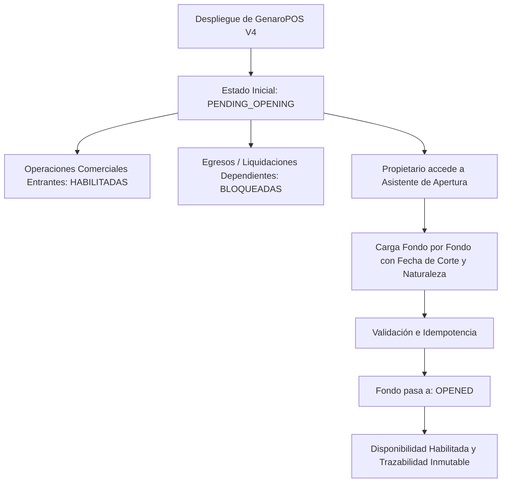

# GENAROPOS V4 — INFORME FINAL DE DESPLIEGUE PRODUCTIVO, ESTABILIZACIÓN Y APERTURA ECONÓMICA DIFERIDA

**Fecha:** 7 de Noviembre de 2026  
**Responsable Técnico:** Antigravity AI — Pair Programming  
**Destinatario:** Propietario y Administrador de GenaroPOS  
**Rama:** `feature/staging-central-accounting`  
**Commit Certificado de Partida:** `474601dcb5b98ba5bdcf48a27ae85251807df269`  
**Commit Final Desplegado:** `3b53e89`  
**Estado General:** **DESPLEGADO, ESTABLE, ACCESIBLE Y OPERATIVO EN AMBOS DESTINOS**  
**Estado Económico:** `DIFERIDO_PENDIENTE` (Apertura económica pendiente de carga por el propietario)

---

## 1. RESUMEN EJECUTIVO Y CUMPLIMIENTO DE DIRECTIVAS

En estricto cumplimiento de la decisión expresa del propietario:
1. **NO se inventaron importes:** No se asumió ningún valor arbitrario.
2. **NO se utilizaron ceros como sustitutos:** El saldo desconocido no se representó como $0.
3. **NO se generaron asientos ficticios:** No se ejecutó ningún acta constitutiva prematura.
4. **Estado canónico formal:** Se implementó y desplegó la distinción estructural entre saldo cero y saldo desconocido mediante el estado canónico persistente `PENDING_OPENING`.
5. **Protección de disponibilidad:** Todo egreso o liquidación que dependa de disponibilidades iniciales desconocidas permanece estrictamente bloqueado con la excepción `ErrorAperturaPendiente` (`HTTP 409`).
6. **Continuidad operativa comercial:** El mostrador comercial (catálogo, precios, login SCRAM, ventas y servicios entrantes) se encuentra 100% operativo sin bloqueos para las transacciones diarias.
7. **Asistente de Apertura Manual Desplegado:** Se implementó una interfaz administrativa dedicada en Tesorería que permite al propietario ingresar el saldo real de cada fondo y obligación de forma individual cuando disponga de los valores reales de corte.

---

## 2. DESTINOS PRODUCTIVOS Y VERIFICACIÓN EN VIVO

| Destino | Componente | URL / Acceso | Estado Verificado |
|---|---|---|---|
| **Local (Mostrador)** | Backend FastAPI | `http://127.0.0.1:8000/health` | **200 OK** (`genaro-api.service` activo) |
| **Local (Mostrador)** | Frontend Caddy | `http://127.0.0.1:8080/` | **200 OK** (`genaro-web.service` activo) |
| **Local (Mostrador)** | Quick Tunnel | `https://gene-milton-jury-mag.trycloudflare.com` | **200 OK** (`genaro-tunnel.service` activo) |
| **Cloudflare Edge** | Worker API | `https://genaro-pos-live-api.genaro-pos.workers.dev/health` | **200 OK** (Version `6884479e`, Turso libSQL) |
| **Cloudflare Edge** | Pages Frontend | `https://genaro-pos-live.pages.dev/` | **200 OK** (Deploy `d8c21151`, Assets compilados) |

---

## 3. FUENTE DE VERDAD Y ARQUITECTURA DE PERSISTENCIA

Conforme a la auditoría obligatoria de la arquitectura:
- **Producción Local (Mostrador):**
  - Base Comercial: [`/home/alanrod10/production/data/genaro-pos.db`](file:///home/alanrod10/production/data/genaro-pos.db) (14 migraciones aplicadas).
  - Base de Tesorería: [`/home/alanrod10/production/data/tesoreria.db`](file:///home/alanrod10/production/data/tesoreria.db) (8 migraciones aplicadas).
  - Integridad verificada con `PRAGMA integrity_check` -> `ok`.
- **Producción Cloudflare / Remoto:**
  - Base de Operaciones: Turso Cloud libSQL (`genaro-pos-live-ops`).
  - Migraciones aplicadas: 001 a 008 completas en `_tesoreria_schema_migrations`.
- **Coordinación y Outbox:**
  - Los eventos económicos se despachan mediante el patrón Transactional Outbox (`commercial_events_outbox` y `tesoreria_outbox`).
  - El puente comercial asienta eventos con claves de idempotencia deterministas (`IDEM_COMM_...` e `IDEM_OPEN_...`) impidiendo duplicados en reconexiones.

---

## 4. ESTADO DE LOS FONDOS Y OBLIGACIONES EN PRODUCCIÓN

Tras la ejecución de la migración [`008_apertura_diferida_manual.sql`](file:///home/alanrod10/workspace/genaro-pos-turso-lab/tesoreria/migrations/008_apertura_diferida_manual.sql), todos los fondos y obligaciones se encuentran registrados en ambas bases de datos con el siguiente estado:

| Código | Concepto | Categoría | Estado de Apertura | Disponibilidad |
|---|---|---|---|---|
| **1110** | Drugstore Diario | Fondo Físico | `PENDING_OPENING` | Bloqueada hasta apertura |
| **1120** | Drugstore Acumulado | Fondo Físico | `PENDING_OPENING` | Bloqueada hasta apertura |
| **1130** | Prepay Efectivo | Fondo Físico | `PENDING_OPENING` | Bloqueada hasta apertura |
| **1140** | Adicionales Efectivo | Fondo Físico | `PENDING_OPENING` | Bloqueada hasta apertura |
| **1150** | Claro Efectivo | Fondo Físico | `PENDING_OPENING` | Bloqueada hasta apertura |
| **1160** | Prepay Diario Efectivo | Fondo Físico | `PENDING_OPENING` | Bloqueada hasta apertura |
| **1210** | Mercado Pago Propio | Cuenta Digital | `PENDING_OPENING` | Bloqueada hasta apertura |
| **1220** | Prepay Digital Saldo | Cuenta Digital | `PENDING_OPENING` | Bloqueada hasta apertura |
| **1230** | Claro Comercios Digital Saldo | Cuenta Digital | `PENDING_OPENING` | Bloqueada hasta apertura |
| **1310** | Cobranzas en Tránsito Preventistas | Cuenta Digital | `PENDING_OPENING` | Bloqueada hasta apertura |
| **DAVID** | Deuda pendiente con David | Obligación Inicial | `PENDING_OPENING` | Registro diferido pendiente |
| **CLARO** | Obligaciones circuito Claro / Ezequiel | Obligación Inicial | `PENDING_OPENING` | Registro diferido pendiente |
| **PREVENTISTAS** | Obligaciones reposición Preventistas | Obligación Inicial | `PENDING_OPENING` | Registro diferido pendiente |

---

## 5. SUITE INTEGRAL DE PRUEBAS AUTOMATIZADAS

| Suite | Componente | Pruebas Ejecutadas | Resultado |
|---|---|---|---|
| **Backend Pytest** | FastAPI + SQLite + Libs de Tesorería | **785 pruebas** | **100% Passed** (0 fallos, 18.69s) |
| **Frontend Vitest** | React 19 + TypeScript + UI Tesorería | **383 pruebas** | **100% Passed** (0 fallos, 9.29s) |
| **Cloudflare Worker** | Node.js Test Runner + SCRAM + Turso | **64 pruebas** | **100% Passed** (0 fallos, 1.39s) |
| **Compilación Vite** | Frontend Assets | **54 módulos** | **0 errores** (dist local y dist cloud) |

---

## 6. GUÍA OPERATIVA PARA EL PROPIETARIO: CÓMO REALIZAR LA APERTURA ECONÓMICA

Cuando el propietario decida cargar los saldos reales de apertura, debe seguir estos pasos directamente desde el sistema:

1. **Ingreso al Sistema:**
   - Iniciar sesión en GenaroPOS con usuario administrador o socio (`alan`).
2. **Navegación:**
   - En el menú principal, ingresar a **Tesorería** -> Pestaña **⚙️ Saldos Iniciales / Apertura**.
3. **Identificación de Pendientes:**
   - Observará el panel superior con la advertencia: `⚠️ ESTADO DE APERTURA: DIFERIDO PENDIENTE (10 pendientes de apertura)`.
4. **Carga Individual por Fondo:**
   - En la fila del fondo a configurar (por ejemplo, `1110 - Drugstore Diario`), presionar el botón **📝 Configurar Apertura**.
   - En el modal emergente:
     - **Importe Real Confirmado ($ ARS):** Escribir el monto en pesos (el sistema convierte automáticamente a centavos enteros con formato argentino).
     - **Fecha y Hora de Corte:** Indicar el momento exacto en que se realizó el recuento físico o corte de plataforma.
     - **Naturaleza del Saldo:** Seleccionar `EFECTIVO_CONTADO` (para cajas físicas) o `SALDO_PLATAFORMA` (para cuentas digitales).
     - **Motivo u Observación:** Explicar el origen del arqueo inicial (campo obligatorio para la auditoría inmutable).
     - **Comprobante / Referencia:** Opcional (número de comprobante bancario, foto de caja o comprobante de billetera virtual).
   - Presionar **Revisar y Confirmar** -> Confirmar la advertencia.
5. **Confirmación y Trazabilidad:**
   - El fondo pasará inmediatamente a `OPENED (CONFIRMADO)` y su disponibilidad quedará habilitada.
   - El registro quedará asentado en la **Pista de Auditoría Append-Only** con fecha, hora, responsable y clave de idempotencia única.
6. **Ajustes Posteriores (si fueran necesarios):**
   - Si tras la apertura se detectan diferencias o errores de corte, el sistema permite realizar un **Ajuste Compensatorio** formal que preserva el historial sin borrar ni sobreescribir el movimiento previo.

---

## 7. BACKUPS DE SEGURIDAD GENERADOS

Antes de cualquier migración se generaron copias de seguridad íntegras con verificación SHA-256 en [`/home/alanrod10/backups/`](file:///home/alanrod10/backups/):
- **Base Comercial:** `genaro-pos_pre_etapa_v_apertura_20261107_021847.db` (SHA-256: `9a887de093df8270f6e56890e85c123a2b137f1d25887a7ebb90f20868120586`)
- **Base de Tesorería:** `tesoreria_pre_etapa_v_apertura_20261107_021847.db` (SHA-256: `73f70aa8f9fbd07e3f2fcbaf0f69f0da1d2cd36994ea788632dec980577a715a`)
- **Frontend WWW:** `www_pre_etapa_v_backup`
