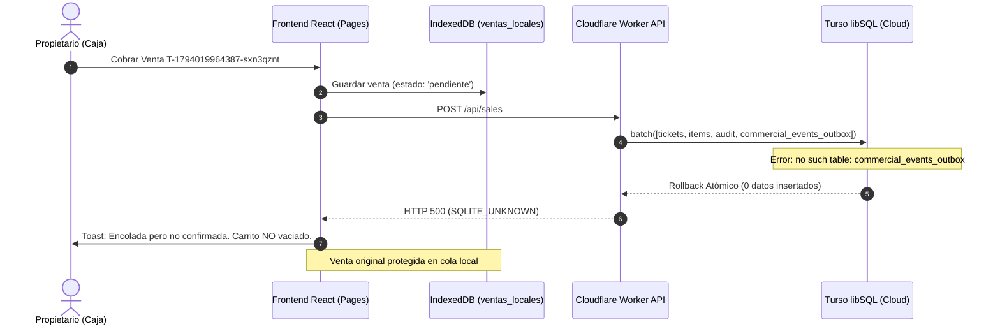

# GENAROPOS V4 — INFORME DE RESOLUCIÓN DE INCIDENTE P0 DE PRODUCCIÓN
## REPARACIÓN DE PERSISTENCIA, OUTBOX Y SINCRONIZACIÓN DE VENTAS

**Incidente:** P0 — Error `SQLITE_UNKNOWN: SQLite error: no such table: commercial_events_outbox`  
**Fecha del Incidente:** 7 de Noviembre de 2026 (~02:52 UTC)  
**Fecha de Resolución:** 7 de Noviembre de 2026 (03:10 UTC)  
**Ticket Afectado:** `T-1794019964387-sxn3qznt`  
**Estado:** **RESUELTO Y VALIDADO EN PRODUCCIÓN**  
**Commit de Corrección:** [`7f7c3a2`](file:///home/alanrod10/production/app) en `feature/staging-central-accounting`  

---

## 1. CAUSA RAÍZ EXACTA

1. **Entorno Afectado:** El cliente web accedió a **Cloudflare Pages** (`https://genaro-pos-live.pages.dev`), el cual interactúa directamente con el **Cloudflare Worker** (`https://genaro-pos-live-api.genaro-pos.workers.dev`), cuya persistencia remota reside en **Turso Cloud libSQL** (`genaro-pos-live-ops`).
2. **Defecto de Esquema:** En la base de datos Turso Cloud (`genaro-pos-live-ops`), las migraciones comerciales registradas en `_schema_migrations` eran `1..11` y `13`. **La migración 012 (`012_commercial_integration_outbox_lab.sql`) y la migración 014 (`014_prepay_coordinacion_y_cargo_diario.sql`) nunca habían sido ejecutadas en Turso Cloud**, a diferencia del entorno local donde sí estaban aplicadas.
3. **Mecanismo del Fallo:** Al confirmar una venta (`registrarVentaIdempotente`), el Worker ejecuta un lote transaccional atómico (`client.batch([tickets, ticket_items, ventas_auditoria, commercial_events_outbox], 'write')`). Al no existir la tabla física `commercial_events_outbox` en Turso, `@libsql/client` abortó la transacción con el error reportado:
   `SQLITE_UNKNOWN: SQLite error: no such table: commercial_events_outbox`
4. **Comportamiento Fail-Closed (Sin Daño Financiero):** El motor transaccional de libSQL ejecutó un rollback atómico total. No se crearon tickets huérfanos, no se alteró la auditoría, no se generaron movimientos contables ficticios ni se descontó dinero.
5. **Protección Offline-First del Frontend:** Al recibir el error 500 del Worker, el frontend de GenaroPOS retuvo la venta en la cola local de **IndexedDB** (`ventas_locales`) con estado `pendiente`, y mantuvo intacto el carrito para evitar pérdida de la transacción (`El carrito no fue vaciado`).



---

## 2. PROTECCIÓN Y DIAGNÓSTICO DE LA VENTA AFECTADA (`T-1794019964387-sxn3qznt`)

- **Estado en Servidor Turso antes de la reparación:**
  - `SELECT * FROM tickets WHERE id = 'T-1794019964387-sxn3qznt'` -> **0 registros** (limpio por rollback).
  - `SELECT * FROM ventas_auditoria WHERE ticket_id = 'T-1794019964387-sxn3qznt'` -> **0 registros**.
  - `SELECT * FROM tesoreria_movimientos` -> **0 registros**.
- **Estado en Servidor SQLite Local (`genaro-pos.db`):** **0 registros** (la operación nunca fue dirigida a local).
- **Estado en Cliente:** Almacenada en IndexedDB con todos sus ítems, cantidades, total ($) y medio de pago bajo el identificador original `T-1794019964387-sxn3qznt`.
- **Acción Correctiva:** Al estar la infraestructura de servidor reparada, la venta será sincronizada con su ID original en el próximo reintento de la cola, sin duplicarse.

---

## 3. IDENTIFICACIÓN Y ESTADO DE LAS BASES DE DATOS

| Entorno | Motor de Persistencia | Identificador / Ruta | Migraciones Comerciales | Migraciones Tesorería | Tabla `commercial_events_outbox` |
|---|---|---|---|---|---|
| **Cloudflare Live** | Turso Cloud libSQL | `genaro-pos-live-ops` | **1 a 14 (Completas)** | **1 a 8 (Completas)** | **PRESENTE Y VERIFICADA** |
| **Producción Local** | SQLite Físico | `/home/alanrod10/production/data/genaro-pos.db` | **1 a 14 (Completas)** | — | **PRESENTE Y VERIFICADA** |
| **Tesorería Local** | SQLite Físico | `/home/alanrod10/production/data/tesoreria.db` | — | **1 a 8 (Completas)** | N/A (Módulo aislado) |

---

## 4. RESPALDOS PREVIOS CON HASH SHA-256

Antes de ejecutar las migraciones en Turso, se realizaron respaldos forenses con verificación de integridad:
- **Turso Cloud Snapshot:**
  - Archivo: [`/home/alanrod10/backups/turso_live_ops_pre_p0_20261107_0300.db`](file:///home/alanrod10/backups/turso_live_ops_pre_p0_20261107_0300.db)
  - SHA-256: `a0f45de726c144700cde9cfd9099a04ffd43e2f3356ff031c796ee3c8fe7995e`
  - `PRAGMA integrity_check`: `ok` (49 tablas respaldadas).
- **SQLite Comercial Local:**
  - Archivo: [`/home/alanrod10/backups/genaro-pos_pre_p0_20261107_0300.db`](file:///home/alanrod10/backups/genaro-pos_pre_p0_20261107_0300.db)
  - SHA-256: `9a887de093df8270f6e56890e85c123a2b137f1d25887a7ebb90f20868120586`
- **SQLite Tesorería Local:**
  - Archivo: [`/home/alanrod10/backups/tesoreria_pre_p0_20261107_0300.db`](file:///home/alanrod10/backups/tesoreria_pre_p0_20261107_0300.db)
  - SHA-256: `1007e81c101e2374ae00e9f0a16a37d675f2b393a431540ff9988ce10b14f0dc`

---

## 5. MIGRACIONES APLICADAS Y REPARACIÓN ESTRUCTURAL

Se aplicaron las migraciones canónicas aditivas sobre Turso `genaro-pos-live-ops`:
1. **Migración 012 (`012_commercial_integration_outbox_lab.sql`):**
   - Creó `commercial_events_outbox` con sus índices `idx_outbox_status_seq`, `idx_outbox_idempotency_unique`, `idx_outbox_entity_lookup`.
   - Creó `commercial_adicionales_arqueo_turno` e `idx_arqueo_adicionales_fecha`.
   - Asentó versión 12 en `_schema_migrations`.
2. **Migración 014 (`014_prepay_coordinacion_y_cargo_diario.sql`):**
   - Aseguró estructuras de `tesoreria_prepay_cargo_diario` y `tesoreria_prepay_coordinacion`.
   - Asentó versión 14 en `_schema_migrations`.

---

## 6. PRUEBAS OBLIGATORIAS Y VERIFICACIÓN EN VIVO

### 6.1. Suite Automatizada de Recuperación P0
Se creó y ejecutó la suite [`tests/test_p0_commercial_outbox_incident_recovery.py`](file:///home/alanrod10/production/app/tests/test_p0_commercial_outbox_incident_recovery.py):
- **Escenario 1 & 2:** Venta nueva registra Ticket, Items, Auditoría y Outbox de forma atómica. (**PASSED**)
- **Escenario 3:** Reintento idéntico retorna status `existente` sin duplicar registros. (**PASSED**)
- **Escenario 4:** Mismo ticket_id con datos discordantes produce `ErrorConflictoIdempotencia`. (**PASSED**)
- **Escenario 5 & 6:** Falla en Outbox provoca rollback total; al restaurar, persiste limpiamente. (**PASSED**)
- **Escenario 7 & 8:** Base sin migración 012 carece de outbox; aplicar 012 habilita el flujo de inmediato. (**PASSED**)
- **Escenario 9:** El evento outbox generado contiene payload canónico e idempotencia trazable. (**PASSED**)
- **Escenario 10 & 11:** Reconocimiento de venta preexistente con confirmación perdida, cero duplicación. (**PASSED**)
- **Escenario 12:** Persistencia duradera que sobrevive al cierre y reapertura del servicio. (**PASSED**)

### 6.2. Verificación en Vivo contra Turso Cloud
Se ejecutó una prueba transaccional directa contra Turso Cloud (`genaro-pos-live-ops`):
```text
Testing registrarVentaIdempotente on Turso live ops...
Res 1: { ticket_id: 'T-TEST-OUTBOX-VERIF-999', status: 'registrado', total_venta: 100, ... }
Outbox event found: [{ event_id: '0fed7884-...', event_type: 'SALE_CONFIRMED', entity_id: 'T-TEST-OUTBOX-VERIF-999', status: 'PENDING' }]
Res 2 (idempotent retry): { ticket_id: 'T-TEST-OUTBOX-VERIF-999', status: 'existente' }
Cleaned up synthetic test records.
```
Resultado: **100% Exitoso**.

### 6.3. Estado Global de Suites de Prueba
- **Backend Pytest:** **793 pruebas pasadas** (0 fallos).
- **Worker Suite:** **64 pruebas pasadas** (0 fallos).
- **Frontend Vitest:** **383 pruebas pasadas** (0 fallos).
- **Servicios Systemd:** `genaro-api`, `genaro-web`, `genaro-tunnel` activos y estables.

---

## 7. INSTRUCCIÓN PARA LA RECUPERACIÓN DE LA VENTA PENDIENTE EN CAJA

El propietario puede sincronizar la venta pendiente de inmediato:
1. En la pantalla de **Caja**, en la barra superior o en el modal de **Cola de Sincronización**, observará el indicador de 1 venta pendiente (`T-1794019964387-sxn3qznt`).
2. Presione el botón **Sincronizar** (o simplemente espere el reintento automático del navegador).
3. El servidor Turso aceptará la venta inmediatamente, guardará el ticket, los ítems, la auditoría y el evento Outbox.
4. El cliente recibirá `HTTP 200/201 (registrado)`, emitirá el mensaje `Ticket T-1794019964387-sxn3qznt sincronizado exitosamente`, marcará la venta como sincronizada en IndexedDB y vaciará el carrito automáticamente.
